<p align="center">
  
</p>

<h1 align="center">Sylvra</h1>

<p align="center"><em>A quiet place for focused review.</em></p>

Sylvra is a native macOS app for reviewing **your team's GitHub pull requests**, with your local Claude Code as a second pair of eyes. It is my personal review tool, built around how I review. If it fits your workflow too, you're welcome to use it.

Sylvra is **not a Git client** and not a code generator. It helps you understand a change, find what matters and write clear, factual review comments. You stay the reviewer.

<p align="center">
  <picture><source media="(prefers-color-scheme: dark)" srcset="docs/screenshots/app-30-overview-dark.png">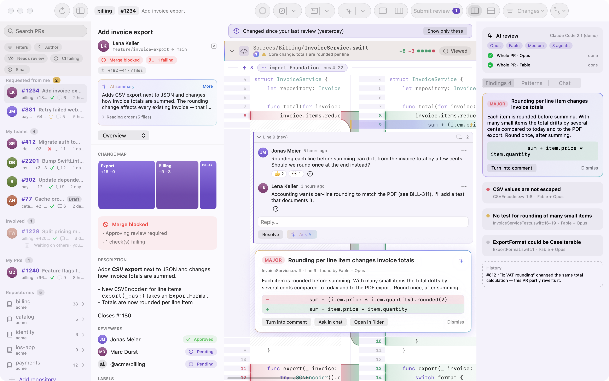</picture>
</p>

**Why "Sylvra"?** The name is a coined word from Latin *silva* and English *sylvan*: forest, wooded. A forest is a quiet place where you can think — that is the mood Sylvra aims for: a calm space to read a change carefully, without the noise of a busy web page. It also fits the subject: code lives in (work-)trees and branches, and a good review sees the forest, not just the trees.

## Install

**Requirements**

- A Mac with Apple silicon and macOS 27 or later
- [Git](https://git-scm.com), installed (e.g. `brew install git`)
- A github.com account and the [GitHub CLI](https://cli.github.com) (`gh`), installed (e.g. `brew install gh`) and logged in with `gh auth login` — Sylvra uses its token
- Optional, for the AI review and chat: [Claude Code](https://docs.claude.com/en/docs/claude-code), installed and logged in

**Steps**

1. Download `Sylvra-<version>.dmg` from the [latest release](https://github.com/mduu/sylvra/releases/latest) (signed and notarized by Apple).
2. Open the DMG and drag **Sylvra** into **Applications**, then start it from there.
3. Install the GitHub CLI and log in once, if you haven't already — Sylvra uses its token:
   ```bash
   brew install gh
   gh auth login
   ```
4. Optional, for the AI review and chat: install [Claude Code](https://docs.claude.com/en/docs/claude-code) and log in.

Sylvra keeps itself up to date: it looks for new releases at launch and every few hours and installs them with one click (*Sylvra → Check for Updates…*).

To try it without a GitHub account, start it with sample data: `open -a Sylvra --args --demo`.

## What it focuses on

### 1. Find what needs you
- **Inbox** of PRs that need you: review requests to you and your teams, PRs you're involved in, your own PRs, recently closed.
- **Your repositories** below the inbox, with their number of open PRs. Open one to browse *all* its open PRs (waiting for you, yours, the rest), searched on GitHub and loaded while you scroll — usable even for a monolith with hundreds of open PRs.
- **Filters**: hide bots (Renovate, Dependabot …), specific authors or other people's drafts; quick chips for author, *needs review*, *CI failing* and small PRs. Right-click a PR to hide its author.
- **Why you're involved**: where you were @-mentioned (description, comments, code comments with file and line), and what is new since your last comment or review (commits, comments, reviews).
- **Waiting on others**: PRs where you acted last are dimmed and grouped, until someone answers. New replies to you show up as *New activity* and as a macOS notification; a click opens the PR.
- Search field and section counts; the last loaded PRs stay available offline.
- Works with large organizations: you choose the repositories, searches stay small, GitHub timeouts are retried and SSO restrictions are explained.

<p align="center">
  <picture><source media="(prefers-color-scheme: dark)" srcset="docs/screenshots/closeup-inbox-dark.png">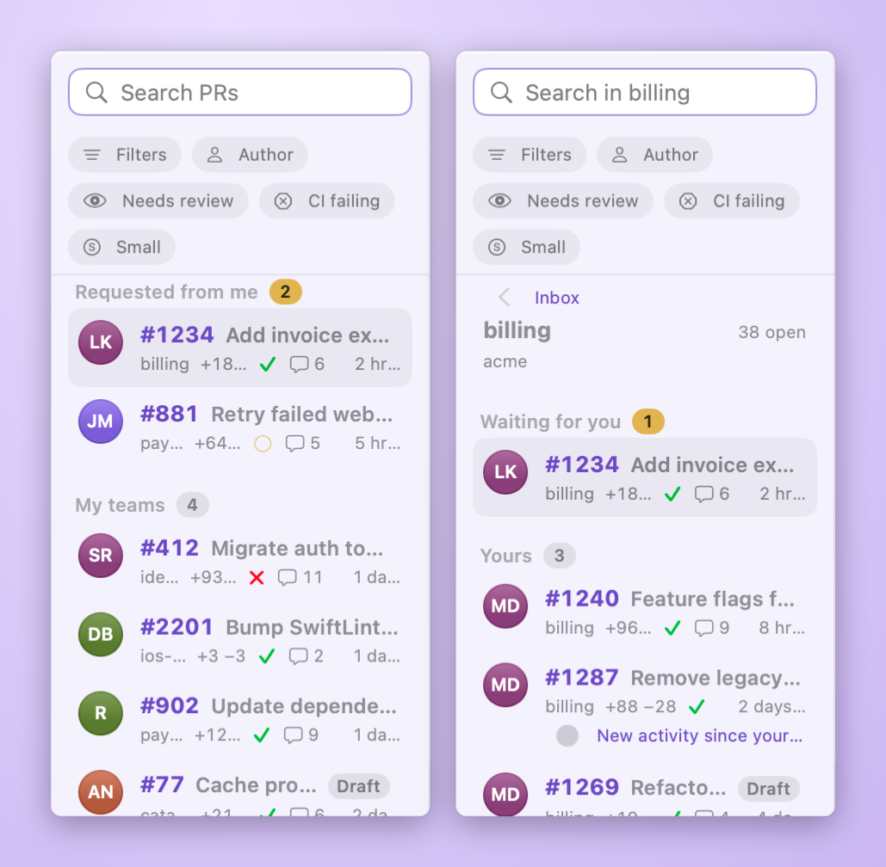</picture>
</p>

### 2. Understand the change quickly
- **PR at a glance**: description (Markdown), reviewers, merge status in plain words, which approvals are still missing, change map, checks, commits.
- **The PR conversation, like on GitHub** (Comments tab): write comments with preview, tone check and writing help, react with emoji, quote-reply, edit and delete your own; updates every minute. Comments render as full Markdown, including what bots post. Code threads are listed separately and jump to their line.
- **Repository and `#number` in the title** open the repository and the pull request on GitHub.
- **AI summary and reading order** pinned above the tabs, visible during the whole review. The diff sorts itself by the reading order.
- **Since my last review**: only what changed since you last reviewed, and new pushes load by themselves (while you write a comment, a banner offers to refresh).
- **Commit by commit**: select a commit and review only its changes; step through with `⌥]` / `⌥[`.
- **Failing checks explained**: click a check to read what it reported (summary, annotations with file and line) without leaving the app.

<p align="center">
  <picture><source media="(prefers-color-scheme: dark)" srcset="docs/screenshots/closeup-pr-at-a-glance-dark.png">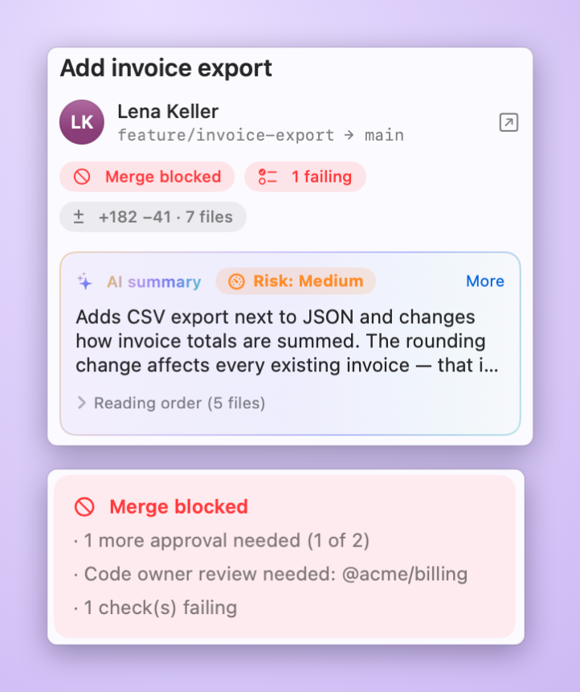</picture><br><br>
  <picture><source media="(prefers-color-scheme: dark)" srcset="docs/screenshots/closeup-reading-order-dark.png">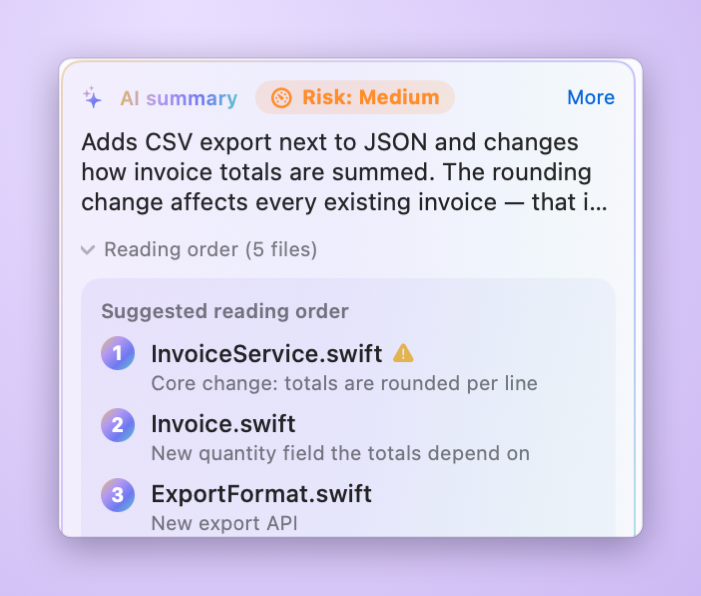</picture><br><br>
  <picture><source media="(prefers-color-scheme: dark)" srcset="docs/screenshots/closeup-check-report-dark.png">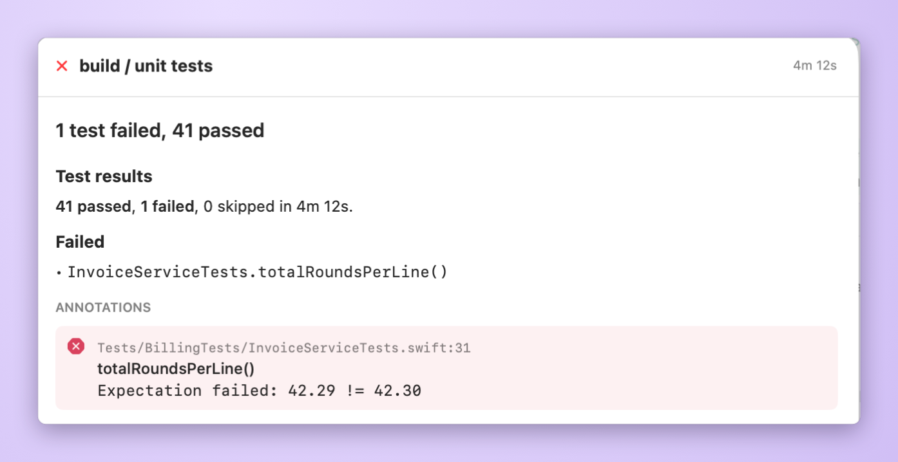</picture><br><br>
  <picture><source media="(prefers-color-scheme: dark)" srcset="docs/screenshots/closeup-new-commits-dark.png">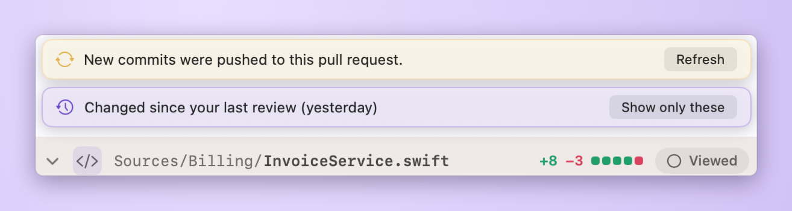</picture><br><br>
  <picture><source media="(prefers-color-scheme: dark)" srcset="docs/screenshots/closeup-commit-by-commit-dark.png">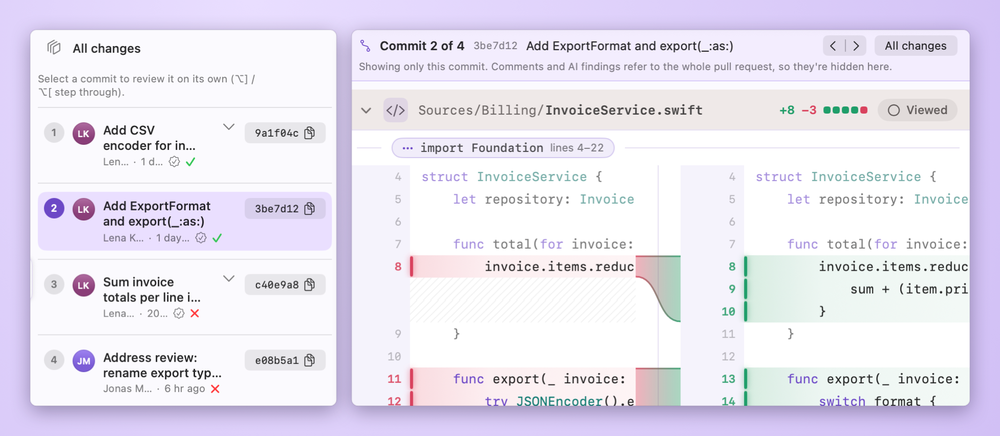</picture>
</p>

### 3. A diff made for reading
- Side by side with a ribbon between old and new, or inline; changed hunks or the selected file in full.
- **Files as a folder tree** with viewed state synced with GitHub. Marking a file *Viewed* collapses it and scrolls straight to the next file still to review.
- Syntax highlighting, intra-line changes, reveal hidden context step by step (+20 / all), long lines scroll sideways.
- Select and copy code across lines, or ask the AI about the selection.
- Review threads and AI findings inline under the lines they belong to, with emoji reactions; the change ribbon keeps running through them.
- Keyboard first: `j`/`k` files, `n`/`p` changes, `v` viewed, `⌘F` find, `⌘K` command palette, `?` for all shortcuts.

### 4. AI as a reviewer's assistant, never as the reviewer
- **One-click AI review** with your locally installed Claude Code, using your repo's `AGENTS.md`, `CLAUDE.md` and specs as context.
- **Several models in parallel** (e.g. Opus + Fable); findings are merged and show who found them. Large PRs are split across agents.
- **Findings in the diff**: a framed box in the AI colors with a ✦ in the gutter, so additions and deletions stay green and red — click it to open the card with rationale and the suggestion as a mini diff.
- **New commits pushed?** Sylvra offers to run the review again on the new code; the old findings are replaced.
- **Risk**: the review rates the PR as a whole (low / medium / high, with reasons) and every finding by impact and likelihood.
- **Patterns**: which conventions the change follows, violates or introduces.
- **Discuss code privately**: ask Claude about selected lines, a finding or a review thread (*Ask AI*) in a private chat. Each topic gets its own chat, earlier chats stay selectable, and you choose model and effort per question. Answers are formatted (headings, lists, code, tables), code references are clickable, and a suggested reply can go straight into the thread.
- **Adjustable AI text size** for chat, findings and summary.
- The AI agents run **read-only** and **never post anything**. A finding becomes a comment only when you turn it into one.

<p align="center">
  <picture><source media="(prefers-color-scheme: dark)" srcset="docs/screenshots/closeup-ai-finding-dark.png">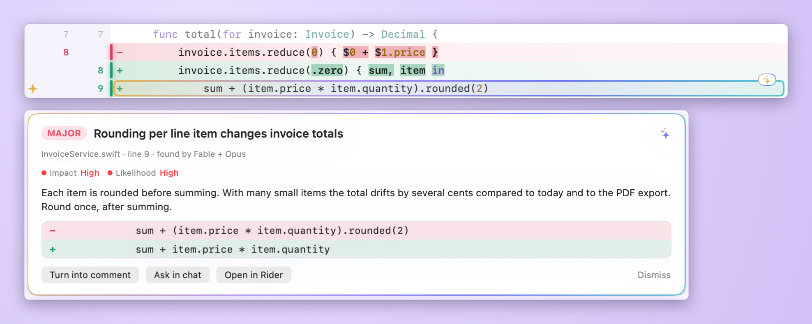</picture><br><br>
  <picture><source media="(prefers-color-scheme: dark)" srcset="docs/screenshots/closeup-ai-panel-dark.png">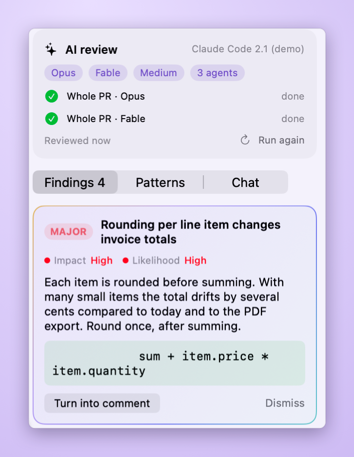</picture><br><br>
  <picture><source media="(prefers-color-scheme: dark)" srcset="docs/screenshots/closeup-ai-chat-dark.png">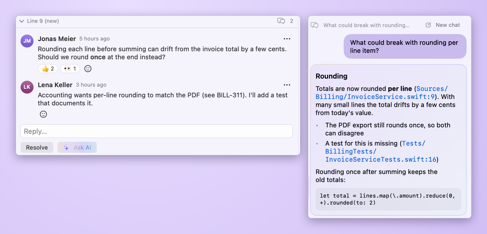</picture><br><br>
  <picture><source media="(prefers-color-scheme: dark)" srcset="docs/screenshots/closeup-finding-to-comment-dark.png">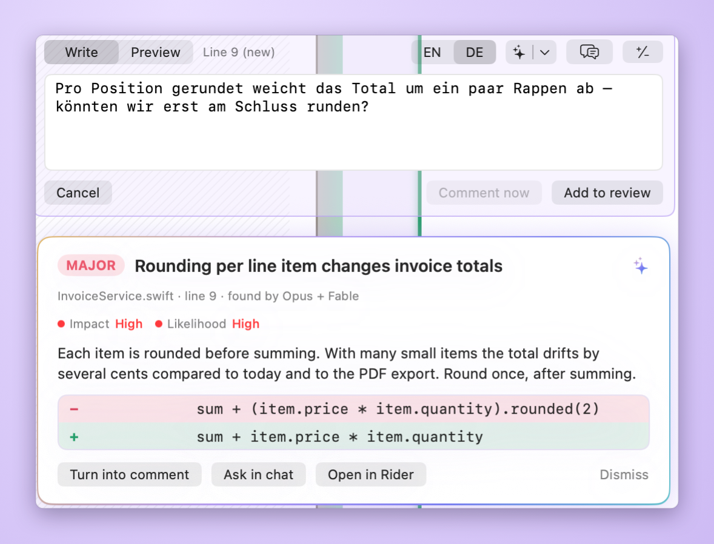</picture>
</p>

### 5. Factual, short review comments
- Comments with code suggestions, replies, resolve, pending reviews and submit.
- **Writing help**: rephrase factually (observation → effect → suggestion), make it shorter, undo.
- **English or German per comment**: switching translates the draft.
- **Tone check** while you type: flags dismissive, absolute or loaded wording ("obviously", "always", "falsch" …) and offers a factual rephrase.

<p align="center">
  <picture><source media="(prefers-color-scheme: dark)" srcset="docs/screenshots/closeup-tone-check-dark.png">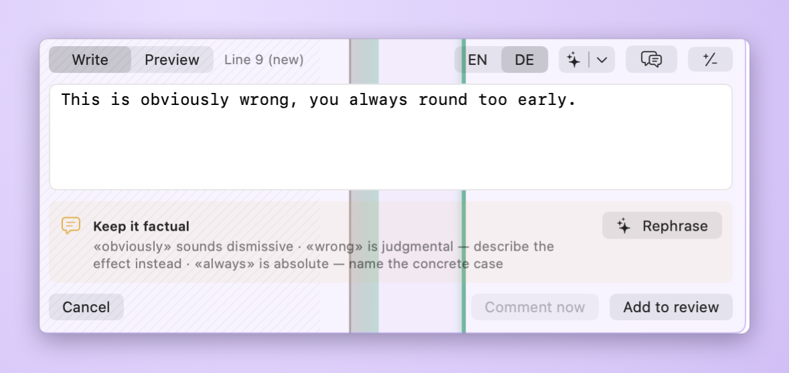</picture><br><br>
  <picture><source media="(prefers-color-scheme: dark)" srcset="docs/screenshots/closeup-conversation-dark.png">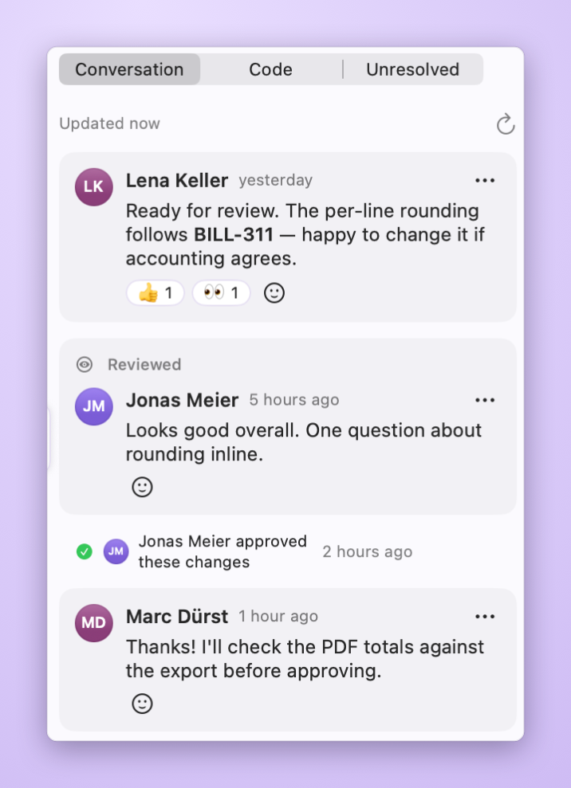</picture>
</p>

### 6. Into the code when needed
- **Open in IDE** (Rider, VS Code, Xcode or the default app) in a Sylvra-managed worktree, so your working copy stays untouched. Jump straight to any line of the diff from its gutter (on hover) or its right-click menu.
- **Worktrees that clean up after themselves**: attached to your existing clone when Sylvra finds one (no extra clone, little disk space; *Settings → Repositories* sets where it looks, e.g. `~/dev`), removed once the PR is merged or closed or after a week unused; never while in use or with changed files. *Settings → Worktrees* lists them all, with *Clean Up Now* and *Show in Finder* (also in the app menu).
- **Terminal panel** in tabs (adjustable font size), *Open in Terminal* with your terminal app, and your own **custom tools** on files, folders and PRs with placeholders like `{file}` or `{headSHA}`.
- **Commands** (`⌥⌘K`): every GitHub request and command Sylvra ran, without tokens or code.
- **Log window** (Help → Show Log, `⌥⌘L`) with the errors of the current run, ready to copy.

### 7. Fits the screen you're on
- **Window layouts** (`⌃⌘0`–`⌃⌘4`): *Automatic*, *Wide* (all columns), *Compact* for laptops (inbox and AI float in on demand), *Focus* (only the diff), *Two windows* for two screens.
- Collapse the inbox and the AI panel with their edge handles; window layout, column widths and window frames are remembered per screen setup (laptop, 34", 49", two 27"…).
- Light, dark or automatic appearance.

<p align="center">
  <picture><source media="(prefers-color-scheme: dark)" srcset="docs/screenshots/closeup-compact-dark.png">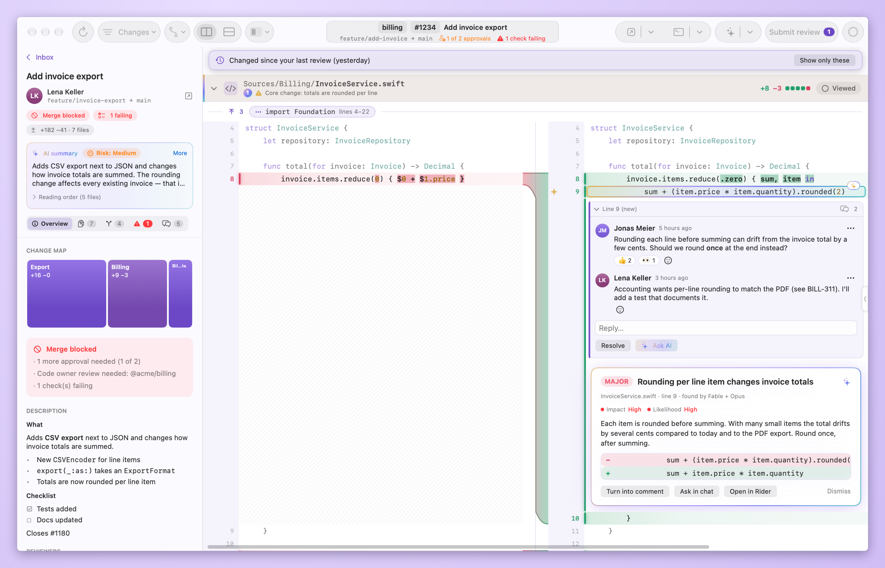</picture>
</p>

## Principles

1. **You review, the AI assists.** AI content is always marked as such and is never posted on its own.
2. **Comments stay factual.** Sylvra nudges towards short, neutral, constructive wording.
3. **Your working copy is yours.** PR checkouts go into separate worktrees; nothing is stashed or changed silently.
4. **No backend, no telemetry.** GitHub tokens stay in the macOS Keychain. Code reaches an AI model only through your own Claude Code, and only when you start a review or chat.

## Status

A personal project, used and developed for my own daily reviews (version 0.6). Expect rough edges — feedback is welcome as an [issue](https://github.com/mduu/sylvra/issues).

To install it, see [Install](#install); to build it yourself, read on.

## Building from source

Needs macOS 27 and Xcode (latest release), plus what the [Install](#install) section lists (`gh` logged in; optionally Claude Code).

```bash
git clone git@github.com:mduu/sylvra.git
cd sylvra
open Sylvra.xcodeproj      # run the "Sylvra" scheme
```

Launch with the argument `--demo` to try the app with sample data, without a GitHub account.

To build an installable, signed and notarized `Sylvra-<version>.dmg` for another Mac (needs a Developer ID certificate):

```bash
xcrun notarytool store-credentials sylvra-notary --apple-id <apple-id> --team-id <team-id>   # once
scripts/release.sh         # → .build/release/Sylvra-<version>.dmg (styled installer window)
scripts/publish.sh         # tag v<version> and publish the DMG as a GitHub Release (--draft to review first)
```

For development:

```bash
scripts/test.sh            # package tests + app build
scripts/lint.sh            # SwiftLint + swift format
scripts/screenshot.sh      # screenshots of the running app (demo data)
```

## Documentation

| Document | Content |
|---|---|
| [specs/projectidea.md](specs/projectidea.md) | Vision, problem, features, non-goals |
| [specs/architecture.md](specs/architecture.md) | Feature slices, integrations (GitHub, git, AI agents, IDEs), CI |
| [specs/ux.md](specs/ux.md) | Layout, interactions, color system, motion, shortcuts |
| [specs/roadmap.md](specs/roadmap.md) · [specs/backlog.md](specs/backlog.md) | What's done and what might come |
| [AGENTS.md](AGENTS.md) | Guidelines for AI coding agents working on this repo |
| [CONTRIBUTING.md](CONTRIBUTING.md) | Issues and pull requests |

## Contributing

Issues and pull requests are welcome. Since this is a personal tool, I'll prioritize what fits my own review workflow and the principles above.

## License

[MIT](LICENSE) © Marc Dürst

## Acknowledgements

Sylvra includes [SwiftTerm](https://github.com/migueldeicaza/SwiftTerm) (MIT License, © Miguel de Icaza and the xterm.js authors) for the terminal panel. The full license texts are in *Sylvra → About Sylvra*.
