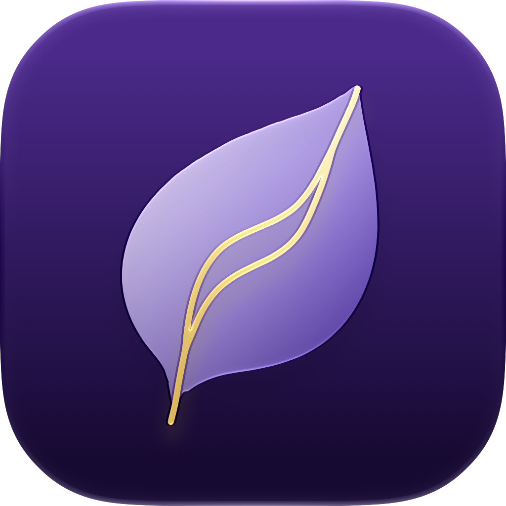
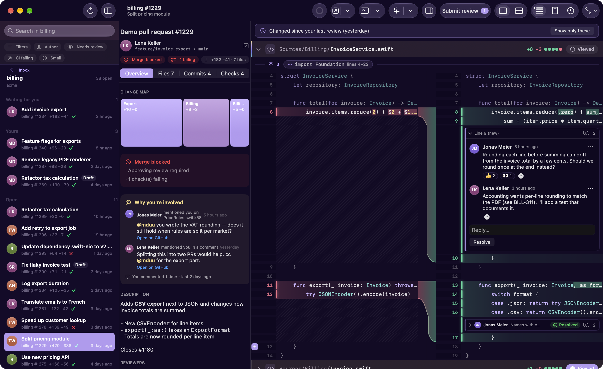
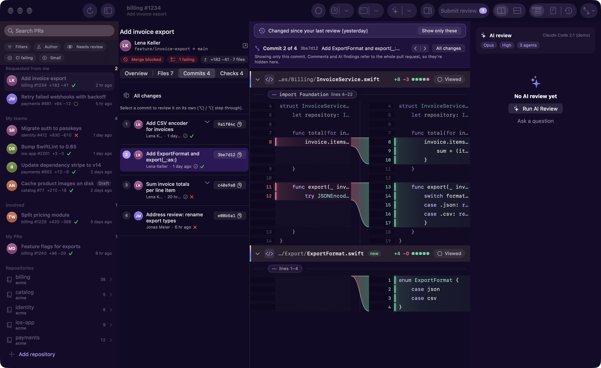
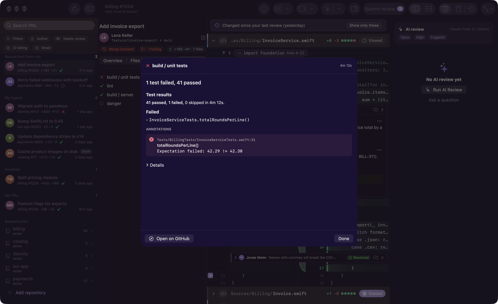

<p align="center">
  
</p>

<h1 align="center">Sylvra</h1>

<p align="center"><em>A quiet place for focused review.</em></p>

Sylvra is a native macOS app for reviewing **your team's GitHub pull requests**, with your local Claude Code as a second pair of eyes. It is my personal review tool, built around how I review. If it fits your workflow too, you're welcome to use it.

Sylvra is **not a Git client** and not a code generator. It helps you understand a change, find what matters and write clear, factual review comments. You stay the reviewer.

<p align="center">
  
</p>

*The name is a coined word from Latin* silva */ English* sylvan *— forest, wooded.*

## What it focuses on

### 1. Find what needs you
- **Inbox** of PRs that need you: review requests to you and your teams, PRs you're involved in, your own PRs, recently closed.
- **Your repositories** below the inbox, with their number of open PRs. Open one to browse *all* its open PRs (waiting for you, yours, the rest), searched on GitHub and loaded while you scroll — usable even for a monolith with hundreds of open PRs.
- **Filters**: hide bots (Renovate, Dependabot …), specific authors or other people's drafts; quick chips for author, *needs review*, *CI failing* and small PRs. Right-click a PR to hide its author.
- **Why you're involved**: where you were @-mentioned (description, comments, code comments with file and line).
- Works with large organizations: you choose the repositories, searches stay small, GitHub timeouts are retried and SSO restrictions are explained.

### 2. Understand the change quickly
- **PR at a glance**: description, reviewers, merge status in plain words, change map, checks, commits.
- **AI summary and reading order** pinned above the tabs, visible during the whole review. The diff sorts itself by the reading order.
- **Since my last review**: only what changed since you last reviewed, plus a banner when someone pushes.
- **Commit by commit**: select a commit and review only its changes; step through with `⌥]` / `⌥[`.
- **Failing checks explained**: click a check to read what it reported (summary, annotations with file and line) without leaving the app.

### 3. A diff made for reading
- Side by side with a ribbon between old and new, or inline; changed hunks or full files.
- Syntax highlighting, intra-line changes, reveal hidden context step by step (+20 / all).
- Review threads and AI findings inline under the lines they belong to, with emoji reactions; the change ribbon keeps running through them.
- Keyboard first: `j`/`k` files, `n`/`p` changes, `v` viewed, `⌘F` find, `⌘K` command palette, `?` for all shortcuts.

### 4. AI as a reviewer's assistant, never as the reviewer
- **One-click AI review** with your locally installed Claude Code, using your repo's `AGENTS.md`, `CLAUDE.md` and specs as context.
- **Several models in parallel** (e.g. Opus + Fable); findings are merged and show who found them. Large PRs are split across agents.
- **Findings in the diff**: highlighted lines — click one to open its card with rationale and the suggestion as a mini diff.
- **Patterns**: which conventions the change follows, violates or introduces.
- **Discuss code privately**: ask Claude about selected lines in a private chat.
- The AI agents run **read-only** and **never post anything**. A finding becomes a comment only when you turn it into one.

### 5. Factual, short review comments
- Comments with code suggestions, replies, resolve, pending reviews and submit.
- **Writing help**: rephrase factually (observation → effect → suggestion), make it shorter, undo.
- **English or German per comment**: switching translates the draft.
- **Tone check** while you type: flags dismissive, absolute or loaded wording ("obviously", "always", "falsch" …) and offers a factual rephrase.

### 6. Into the code when needed
- **Open in IDE** (Rider, VS Code, Xcode or the default app) in a Sylvra-managed worktree, so your working copy stays untouched.
- **Terminal panel** and your own **custom tools** on files and folders.
- **Log window** (Help → Show Log, `⌥⌘L`) with the errors of the current run, ready to copy.

<p align="center">
  
  
</p>
<p align="center">
  
  
</p>

## Principles

1. **You review, the AI assists.** AI content is always marked as such and is never posted on its own.
2. **Comments stay factual.** Sylvra nudges towards short, neutral, constructive wording.
3. **Your working copy is yours.** PR checkouts go into separate worktrees; nothing is stashed or changed silently.
4. **No backend, no telemetry.** GitHub tokens stay in the macOS Keychain. Code reaches an AI model only through your own Claude Code, and only when you start a review or chat.

## Status

A personal project, used and developed for my own daily reviews (version 0.5). There are no published releases: build it from source, or build your own signed DMG (see below). Expect rough edges.

## Requirements

- macOS (latest major release) and Xcode (latest release) to build
- `git`
- A github.com account and the [GitHub CLI](https://cli.github.com) (`gh`), logged in (Sylvra uses its token)
- Optional, for the AI features: [Claude Code](https://docs.claude.com/en/docs/claude-code), installed and logged in

## Getting started

```bash
git clone git@github.com:mduu/sylvra.git
cd sylvra
open Sylvra.xcodeproj      # run the "Sylvra" scheme
```

Launch with the argument `--demo` to try the app with sample data, without a GitHub account.

To build an installable, signed and notarized `Sylvra-<version>.dmg` for another Mac (needs a Developer ID certificate):

```bash
xcrun notarytool store-credentials sylvra-notary --apple-id <apple-id> --team-id <team-id>   # once
scripts/release.sh         # → .build/release/Sylvra-<version>.dmg
```

For development:

```bash
scripts/test.sh            # package tests + app build
scripts/lint.sh            # SwiftLint + swift format
scripts/screenshot.sh      # screenshots of the running app (demo data)
```

## Documentation

| Document | Content |
|---|---|
| [specs/projectidea.md](specs/projectidea.md) | Vision, problem, features, non-goals |
| [specs/architecture.md](specs/architecture.md) | Feature slices, integrations (GitHub, git, AI agents, IDEs), CI |
| [specs/ux.md](specs/ux.md) | Layout, interactions, color system, motion, shortcuts |
| [specs/roadmap.md](specs/roadmap.md) · [specs/backlog.md](specs/backlog.md) | What's done and what might come |
| [AGENTS.md](AGENTS.md) | Guidelines for AI coding agents working on this repo |
| [CONTRIBUTING.md](CONTRIBUTING.md) | Issues and pull requests |

## Contributing

Issues and pull requests are welcome. Since this is a personal tool, I'll prioritize what fits my own review workflow and the principles above.

## License

[MIT](LICENSE) © Marc Dürst
