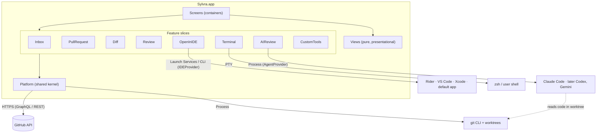
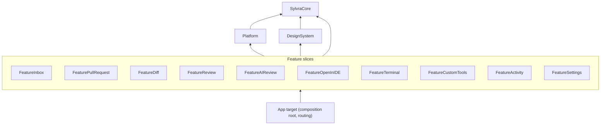
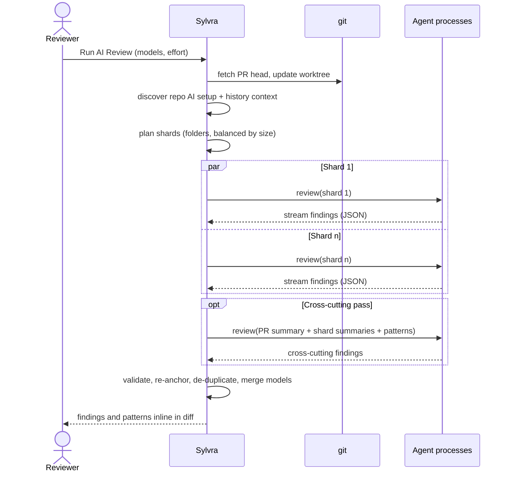
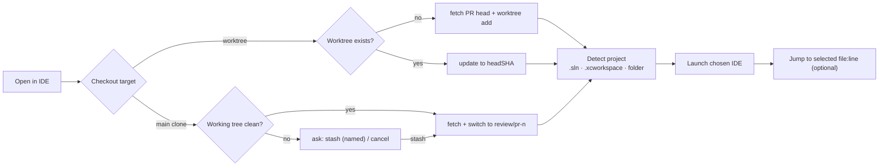

# Sylvra — Architecture

Status: **draft / target architecture**. The code base does not exist yet; this document describes the intended design and is updated as decisions are made.

## 1. Overview

Sylvra is a native macOS app (Swift, SwiftUI, AppKit where needed). It talks to external systems only from the user's machine:



There is **no Sylvra backend**. All data stays on the user's machine, except what is explicitly posted to GitHub and the code an AI agent sends to its provider when the user starts a review or chat.

## 2. Platform and tooling

| Topic | Decision |
|---|---|
| Language | Swift 6, strict concurrency checking enabled |
| UI | SwiftUI first; AppKit (`NSViewRepresentable`) for the diff text rendering, terminal and other performance-critical views |
| Minimum OS | Latest major macOS release (current system materials, e.g. Liquid Glass) |
| State | Observation framework (`@Observable`), no Combine in new code |
| Concurrency | `async/await`, actors for shared mutable state, structured concurrency for parallel agents |
| Project layout | Xcode app target (composition root) + local Swift package `SylvraKit` with one target per feature slice |
| Tests | Swift Testing (`import Testing`); XCTest only for UI tests |
| Lint / format | SwiftLint (lint rules) + `swift format` (formatting), see §14 |
| Dependencies | Keep minimal. Candidates: SwiftTreeSitter (syntax highlighting), GRDB (SQLite cache), SwiftTerm (terminal panel), Sparkle (updates outside the App Store) |

## 3. Code organization: feature slices

The code is organized **by topic (feature)**, inspired by — but not a strict 1:1 implementation of — *vertical slice architecture*:

- Each **feature slice** owns everything it needs for one topic: screens and views, view models, use cases, feature-specific models and adapters.
- Code shared by several slices lives in a small **shared kernel** (`SylvraCore`, `Platform`, `DesignSystem`). Only truly shared things go there — when in doubt, keep it in the slice.
- Pragmatic deviations from strict vertical slices are allowed: e.g. the GitHub client and the git runner are shared infrastructure in `Platform`, not duplicated per slice.

```
sylvra/
├── Sylvra.xcodeproj
├── App/                        # App target: @main, scenes, windows, menus, composition root (DI), routing
├── Packages/SylvraKit/
│   ├── Package.swift
│   ├── Sources/
│   │   ├── SylvraCore/         # Domain models + protocols shared across slices (no UI, no I/O)
│   │   ├── Platform/           # Shared infrastructure: GitHubClient, GitRunner, ProcessRunner, Keychain,
│   │   │                       # Persistence (SQLite), AvatarCache, Logging, Notifications
│   │   ├── DesignSystem/       # Color tokens (from the app icon), typography, materials, animations,
│   │   │                       # AI highlight styles, reusable components (Avatar, Badge, CopyableSHA…)
│   │   ├── FeatureInbox/       # PR inbox: sections, filters, polling
│   │   ├── FeaturePullRequest/ # PR details: overview, description, commits, checks, merge status, conversation
│   │   ├── FeatureDiff/        # Diff engine (parse, intra-line, moved code) + diff screens and rendering
│   │   ├── FeatureReview/      # Comments, threads, suggestions, pending review, submit
│   │   ├── FeatureAIReview/    # Agent providers, review runs, sharding, findings, patterns, chat
│   │   ├── FeatureOpenInIDE/   # IDE providers, checkout target (worktree / main clone), Rider hygiene
│   │   ├── FeatureTerminal/    # Terminal panel (tabs, PTY sessions), external terminal launcher
│   │   ├── FeatureCustomTools/ # User-defined commands for files / folders / PRs
│   │   ├── FeatureActivity/    # Background jobs, activity indicator, completion notifications
│   │   └── FeatureSettings/    # Settings screens
│   └── Tests/                  # One test target per slice and shared module
├── scripts/                    # lint, format, release helpers
├── .github/workflows/          # PR validation (see §14)
├── specs/
└── AGENTS.md
```

### 3.1 Inside a slice

```
FeatureDiff/
├── Screens/      # DiffScreen — container: owns view model, loading, side effects
├── Views/        # DiffLineView, HunkHeaderView … — pure, presentational
├── ViewModels/   # DiffScreenModel (@Observable, @MainActor)
├── Domain/       # FileDiff, Hunk, DiffLine, IntraLineDiff — slice-specific models and logic
├── Services/     # Use cases, e.g. LoadDiffUseCase, ComputeMovedCode
└── Adapters/     # Slice-specific infrastructure (if any)
```

### 3.2 Dependency rules



- Slices **do not import each other**. Cross-slice navigation and composition happen in the `App` target (router / composition root) or via protocols defined in `SylvraCore`.
- `SylvraCore` depends on nothing. `Platform` and `DesignSystem` depend only on `SylvraCore`.

### 3.3 View layer: containers and presentational views

SwiftUI views follow the **container / presentational** pattern (also known as *smart / dumb* views):

| Suffix | Role |
|---|---|
| `*Screen` | Top-level navigation destination (e.g. `PullRequestScreen`). **Container**: owns its `*ScreenModel`, triggers loading and side effects (network, git, agents), maps state to views. |
| `*Panel`, `*Inspector`, `*Sheet` | Containers for a region of a screen (terminal panel, findings inspector, submit-review sheet). May own state and side effects. |
| `*View` | **Presentational and as pure as possible**: data in, closures out. No services, no `Task {}` with side effects, no environment lookups of services. |
| `*Row`, `*Cell`, `*Badge` | Small presentational building blocks. |
| `*ScreenModel` / `*Model` | `@Observable @MainActor` view model of a screen or panel. |

Pure views are easy to preview and test (SwiftUI previews with fixture data); all side effects stay in the containers above them.

## 4. Domain model (core)

```swift
struct RepositoryRef      { owner, name, defaultBranch, localClonePath?, preferredIDE? }
struct UserRef            { login, name?, avatarURL? }
struct PullRequest        { id, number, repo, title, body, author: UserRef, state, isDraft,
                            baseRef, headRef, headRepo, headSHA, baseSHA, labels, assignees,
                            reviewRequests, reviews, milestone?, linkedIssues,
                            mergeState: MergeState, checks: [CheckRun],
                            additions, deletions, changedFiles, createdAt, updatedAt,
                            lastViewedByMeAt? }
struct MergeState         { mergeable, isBehindBase, hasConflicts, blockedReasons, mergeQueueState? }
struct CheckRun           { name, status, conclusion, startedAt?, completedAt?, detailsURL }
struct Commit             { sha, shortSHA, subject, body, author: UserRef, committer: UserRef,
                            authoredAt, isVerified, checkState? }
struct ChangedFile        { path, previousPath?, status, additions, deletions,
                            kind: .source | .test | .config | .generated | .lockfile | .asset | .docs,
                            viewed: Bool }
struct ReviewThread       { id, path, line, side, isResolved, isOutdated, comments: [ReviewComment] }
struct ReviewFinding      { id, path, startLine, endLine, side, severity, category,
                            title, rationale, suggestion?, confidence, sources: [AgentSource] }
struct PatternFinding     { id, name, verdict: .followed | .violated | .introduced,
                            rationale, evidence: [CodeLocation] }
struct ReviewRun          { id, pr, headSHA, commitRange?, agents: [AgentSource], shards, status,
                            findings, patterns, summary, startedAt, finishedAt }
struct AgentSource        { provider, model, effort }
```

Diff-specific models (`FileDiff`, `Hunk`, `DiffLine`) live in `FeatureDiff/Domain`; only stable line identities (`CodeLocation`) are shared via `SylvraCore`.

## 5. GitHub integration (`Platform/GitHubClient`)

- **API**: GraphQL v4 for PR lists, PR details, commits, checks, review threads and review mutations; REST v3 where simpler (raw diffs, file contents).
- **Authentication**: token from the GitHub CLI (`gh auth token`) if available, otherwise OAuth device flow. Tokens are stored in the **Keychain** only.
- **Inbox queries**: search qualifiers such as `is:pr is:open review-requested:@me`, `team-review-requested:<org>/<team>`, `involves:@me`, plus configured watched repositories and path rules (CODEOWNERS-like, evaluated locally).
- **Refresh**: polling with conditional requests (`ETag`), adaptive interval (faster when active, slower in background), respecting rate limits.
- **Review parity** — everything GitHub offers for reviewing:
  - pending review with inline comments and ```` ```suggestion ```` blocks (`addPullRequestReview`, `addPullRequestReviewThread`, `submitPullRequestReview`),
  - reply to threads, resolve / unresolve (`resolveReviewThread`, `unresolveReviewThread`), edit / delete own comments, reactions,
  - mark files as viewed (`markFileAsViewed` / `unmarkFileAsViewed`).
- **Deep links**: every entity keeps its GitHub `url` (PR, commit, check run `detailsURL`, comment) so the UI can open it in the browser with one click.
- **Avatars**: `avatarUrl` of users is loaded via a shared `AvatarCache` (memory + disk, `URLCache`), with initials as fallback.
- Every write is an explicit user action. AI findings are never posted automatically.

## 6. Local Git integration (`Platform/GitRunner`)

Sylvra uses the **system `git` binary** via `Process` (wrapped in an `actor GitRunner`), not libgit2. This guarantees identical behavior to the user's setup (credentials, LFS, SSH, config).

- **Repository mapping**: each GitHub repo can be mapped to an existing local clone (auto-detected by scanning configured folders and matching `remote.origin.url`). If none exists, Sylvra can create a cache clone in `~/Library/Application Support/Sylvra/repos/`.
- **Local diffs**: full-file mode, very large PRs (GitHub truncates diffs), "changes since last review", **per-commit diffs** (`git show`, `git diff <a>..<b>`), moved-code detection.
- **History for AI context**: `git log` / `git blame` on touched paths and the merge commits / merged PRs that last changed them (see §8.3).

## 7. Diff engine (`FeatureDiff`)

- **Input**: unified diff (GitHub or local git) + optionally both full file versions.
- **Model**: `FileDiff → [Hunk] → [DiffLine]` with stable line identities (path + side + line number) used for anchoring comments and AI findings.
- **Ranges**: whole PR, since last review, single commit, commit range.
- **Intra-line diff**: token/word-level diff (Myers on tokens) for modified line pairs.
- **Presentation modes** (view-model transforms on the same model): side-by-side / inline, focused (N context lines, expandable) / full file.
- **Syntax highlighting**: tree-sitter grammars, tokenized off the main thread, cached per blob SHA.
- **Rendering**: TextKit 2 based `NSTextView` or a custom virtualized `NSView`, hosted in SwiftUI — required for smooth 120 fps scrolling of 10k+ line diffs, custom line backgrounds, gradient AI highlights, connector ribbons between panes and animated hunk expansion (see `ux.md` §6).
- **Decorations layer**: comments, AI findings, pattern evidence and selections are overlays keyed by line identity, independent of the diff text.

## 8. AI integration (`FeatureAIReview`)

### 8.1 Agent providers

Sylvra drives **locally installed AI agent CLIs** as child processes. It never calls provider APIs directly and never handles AI credentials — it uses the user's existing CLI login and settings.

```swift
protocol AgentProvider: Sendable {
    var id: AgentProviderID { get }                 // .claudeCode, later .codex, .gemini
    func detect() async -> AgentInstallation?       // binary path, version, login state
    func capabilities() async -> AgentCapabilities  // models, effort levels, structured output, resume
    func review(_ request: ReviewRequest) -> AsyncThrowingStream<ReviewEvent, Error>
    func chat(_ message: ChatMessage, session: ChatSession) -> AsyncThrowingStream<ChatEvent, Error>
}
```

- **MVP**: `ClaudeCodeProvider` (Claude Code CLI in non-interactive print mode, streaming JSON output).
- **Later**: `CodexProvider`, `GeminiProvider`, … behind the same protocol.
- **Capability detection** at startup (`--version`, `--help`): supported flags (model, effort, output format, structured output, session resume) are detected at runtime instead of hardcoded.
- **Working directory**: the PR worktree (or main clone), so the agent can read the full code base.
- **Permissions**: review runs use a **read-only tool set** (read, grep, glob, `git diff/log/show/blame`). No file edits, no network side effects.

### 8.2 Model selection

- Global defaults in settings: provider, model (e.g. Opus, Fable), effort.
- **Per-PR override** in a few clicks (stored per PR).
- **Multi-model review** (optional): the same request runs with several `AgentSource`s in parallel; findings are merged and marked with the models that reported them ("found by Opus + Fable").

### 8.3 Review context

A `ReviewRequest` contains:

- PR metadata (title, description, linked issues), base/head SHA, commit list, selected range (whole PR / since last review / commit),
- files in scope (shard),
- **repository AI setup**, discovered by `RepoContextDiscovery`:
  - `AGENTS.md`, `CLAUDE.md` (including `@file` imports), `README.md`,
  - folders referenced from those files — typically `specs/`, `docs/`, `ai/` — and other well-known agent instruction files,
  - Sylvra's per-repo custom review prompt;
- **history context**: recent commits and merged PRs touching the same paths, so the agent can relate the change to earlier decisions ("this reverts the fix from #812"),
- selected model and effort, the **agent language** (see §8.6) and the required output schema.

### 8.4 Structured output

```json
{
  "summary": "string",
  "findings": [{
    "path": "Sources/Billing/Invoice.swift",
    "startLine": 42, "endLine": 48, "side": "RIGHT",
    "severity": "critical | major | minor | nit",
    "category": "bug | security | performance | concurrency | design | tests | style | pattern",
    "title": "string",
    "rationale": "string (markdown)",
    "suggestion": "optional replacement code for startLine..endLine",
    "confidence": 0.0
  }],
  "patterns": [{
    "name": "Repository pattern",
    "verdict": "followed | violated | introduced",
    "rationale": "string (markdown)",
    "evidence": [{ "path": "…", "startLine": 10, "endLine": 20, "side": "RIGHT" }]
  }],
  "history": [{ "ref": "commit SHA or PR number", "relation": "string" }]
}
```

Findings and pattern evidence are **validated** against the actual diff: paths must exist, line ranges must be inside the file. Invalid locations are re-anchored (nearest hunk) or marked "unanchored" instead of silently dropped.

### 8.5 Parallel agents (sharding)



1. **Shard planning**: group changed files by namespace/folder, balance by changed-line count, keep related files (source + tests) together, exclude noise.
2. **Execution**: one agent process per shard (× per model), limited by `maxParallelAgents` (setting) via a `TaskGroup` with a concurrency limiter.
3. **Cross-cutting pass** (optional): catches issues spanning shards and consolidates pattern analysis.
4. **Merge**: de-duplicate findings (same location + similar title), order by severity, attach sources.

Small PRs automatically use a single agent (threshold configurable).

### 8.6 Chat and language

- One chat session per PR, run in the PR worktree, resumable via the provider's session mechanism.
- Answers containing `path:line` references become clickable links into the diff.
- **Agent language** (setting, default: system language): all agent-to-user communication (summaries, rationales, chat) is requested in this language.
- **Comment language** (separate setting, default: English): used when a finding is turned into a GitHub comment, since repositories are usually English.

### 8.7 Persistence of AI results

Review runs and chat transcripts are stored locally, keyed by `(repo, pr, headSHA, range)`. After new pushes, findings from older runs are shown as **outdated**, with best-effort line re-mapping.

## 9. IDE integration (`FeatureOpenInIDE`)

### 9.1 Providers

```swift
protocol IDEProvider: Sendable {
    var id: IDEProviderID { get }        // .rider, .vsCode, .xcode, .defaultApp, later .cursor, .zed, .intelliJ …
    func isInstalled() async -> Bool
    func open(project: URL, file: URL?, line: Int?) async throws
}
```

| IDE | Detection | Open project | Open file at line |
|---|---|---|---|
| JetBrains Rider | Bundle ID / Toolbox paths, `rider` launcher | launcher or `open -a` | launcher `--line <n> <file>` |
| Visual Studio Code | Bundle ID, `code` CLI | `code <dir>` | `code --goto <file>:<line>:<col>` |
| Xcode | Bundle ID, `xed` | `xed <dir / .xcodeproj / .xcworkspace>` | `xed --line <n> <file>` |
| Default app | Launch Services (`NSWorkspace`) | app registered for the project file / folder | — |

- **Per-repo default IDE** plus **quick switch** on every "Open in…" action (e.g. open a VS Code project in Rider).
- Project detection: `.sln` / `.slnx`, `.xcworkspace` / `.xcodeproj`, `.code-workspace`, folder.

### 9.2 Checkout target

| Target | When | Behavior |
|---|---|---|
| **Worktree** (default) | Normal review | `git fetch origin pull/<n>/head` → worktree at `headSHA` in `~/Library/Application Support/Sylvra/worktrees/<repo>/…`. The main working copy is untouched. |
| **Main clone** | Projects that cannot run from a worktree, or when the reviewer wants to run the app in their usual setup | Explicit choice per click or per repo. Sylvra checks for a clean working tree; if dirty, it asks (stash with a named message / cancel) — never silently. Checks out a local branch `review/pr-<n>` at the PR head and offers to switch back to the previous branch afterwards. |



### 9.3 Rider hygiene

Rider keeps every opened folder in its *recent projects*; deleted worktrees remain there as broken entries. Mitigations (in order of preference):

1. **Stable review worktree per repo**: one worktree path per repository that is re-pointed to the PR under review — Rider sees a single, always-valid recent entry.
2. **Cleanup**: when Sylvra removes a worktree, it removes matching entries from Rider's recent-projects storage (in `~/Library/Application Support/JetBrains/Rider*/options/`), only while Rider is not running and with a backup.
3. **"Don't track as recent" launch option**: to be investigated — no supported Rider CLI flag is known so far.

## 10. Terminal and custom tools

- **Terminal panel** (`FeatureTerminal`): embedded terminal emulator (SwiftTerm) with PTY sessions in tabs; new sessions start in the PR worktree / clone; sessions survive switching PRs.
- **External terminal**: "Open in Terminal" with the configured app (Terminal, iTerm2, Ghostty, Warp, …).
- **Custom tools** (`FeatureCustomTools`): user-defined commands with scope (*file*, *folder*, *PR*), working directory and placeholders such as `{file}`, `{folder}`, `{repoRoot}`, `{worktree}`, `{prNumber}`, `{headSHA}`, `{baseSHA}`. Placeholders are passed as escaped arguments; output goes to a terminal tab or a background job.

## 11. Background work and notifications (`FeatureActivity`)

- Every long-running operation (AI review, chat answer, fetch, worktree preparation, custom tool) is a **job** registered with an `ActivityCenter` (`@Observable`): progress, cancellation, result.
- The UI shows an activity indicator in the toolbar and an activity popover listing running jobs.
- When a job finishes and the app is **not active**, a macOS notification (UserNotifications) is posted — configurable per job type. Clicking it opens the related PR / result.

## 12. Persistence

| Data | Storage |
|---|---|
| GitHub tokens | Keychain |
| User settings | `UserDefaults` / `@AppStorage` (non-secret) |
| PR cache, review runs, findings, patterns, chat transcripts, viewed state, last-reviewed SHA, per-PR overrides | SQLite (GRDB) in Application Support |
| Worktrees, cache clones | `~/Library/Application Support/Sylvra/` (configurable) |
| Avatars | `URLCache` (memory + disk) |
| Syntax token cache | In-memory LRU + on-disk cache keyed by blob SHA |

## 13. Security and privacy

- No telemetry by default. No third-party analytics.
- Tokens only in Keychain; never logged.
- Code is only sent to an AI provider via the user's own agent CLI, and only when an AI review or chat is explicitly started.
- AI agents run with read-only tools.
- All `Process` invocations use argument arrays (no shell string interpolation) to avoid injection via branch names, paths or PR titles. Custom tools are the only place where user-configured shell commands run.

## 14. Quality: linting and CI

### 14.1 Local

- **SwiftLint** (`.swiftlint.yml`) for lint rules, **`swift format`** (`.swift-format`) for formatting.
- `scripts/lint.sh`, `scripts/format.sh` and `scripts/test.sh` (package tests + app build); optional Git pre-commit hook.
- SwiftLint also runs as an Xcode build phase (warnings in the IDE).

### 14.2 GitHub Actions (PR validation)

The repository is public (MIT), so standard GitHub-hosted runners are free. The workflow is still kept lean — fast feedback, low noise, no waste of shared resources:

| Rule | Implementation |
|---|---|
| Run only where needed | Trigger on `pull_request` to `main` only (no duplicate `push` runs); `paths-ignore` for `**/*.md`, `specs/**`, `assets/**`. |
| Fast first | `lint` job on `ubuntu-latest` (SwiftLint + `swift format lint`); the slower macOS job runs only if lint passes. |
| Short macOS job | `build-and-test` on `macos-latest`: `xcodebuild test`, `timeout-minutes: 20`. |
| No waste | `concurrency` with `cancel-in-progress: true`; no artifact uploads; small SPM cache keyed on `Package.resolved`. |
| Updates | Dependabot for GitHub Actions and SPM, monthly. |

There is **no CD on GitHub**. Releases are built and uploaded locally.

### 14.3 Release (local)

Like SolarLens, releases are done from the developer machine, driven by Claude Code commands (e.g. `/deploy-testflight`, `/deploy-release`):

1. Bump build number in the Xcode project.
2. `xcodebuild archive` into Xcode's dated archive folder (so it shows up in Organizer).
3. `xcodebuild -exportArchive` with a checked-in `ExportOptions-*.plist`.
4. Tag and GitHub release with generated "What's New" notes.

**Distribution channel and sandboxing** — important constraint: the Mac App Store **and TestFlight for macOS require the App Sandbox**. Sylvra spawns `git`, AI agent CLIs, IDE launchers and terminal shells, which the sandbox largely forbids. Therefore:

- **Primary channel**: Developer ID signed + notarized build (`ExportOptions-developer-id.plist`, `notarytool`), distributed as DMG with Sparkle updates.
- **Homebrew** (option): `brew install --cask sylvra` via an own tap (`mduu/homebrew-tap`, cask `sylvra`). Builds on the notarized DMG; the cask declares `auto_updates true` because Sparkle updates the app itself. The release script bumps `version` and `sha256` in the cask. The official `homebrew/cask` repository is only an option once Sylvra is public and popular enough to meet its notability rules.
  - DMGs are published as **GitHub Releases** of the public `mduu/sylvra` repository; the Sparkle appcast is served from the repository (e.g. GitHub Pages) or attached to the release.
- **App Store / TestFlight**: only if a sandbox-compatible design is found (see open questions). Sandbox-incompatible features would have to be disabled in that build.

## 15. Performance targets

- Inbox visible from cache in < 300 ms after launch; refreshed in background.
- PR essence (change map + file list) in < 1 s for typical PRs.
- Diff view: 120 fps scrolling and animations on ProMotion displays for files with 10k+ lines.
- Main thread never blocks on I/O, git, agent or terminal processes.

## 16. Open questions

- GitHub App vs. OAuth App for the device flow.
- Exact agent CLI flags per provider/version — resolved via runtime capability detection.
- Rider: is there a supported way to open a project without adding it to recent projects?
- App Sandbox feasibility (security-scoped bookmarks for clones, helper tools) — decides whether a Mac App Store / TestFlight build is possible.
- Sparkle appcast hosting: GitHub Pages vs. release asset.
- GitHub Enterprise Server support timing.
