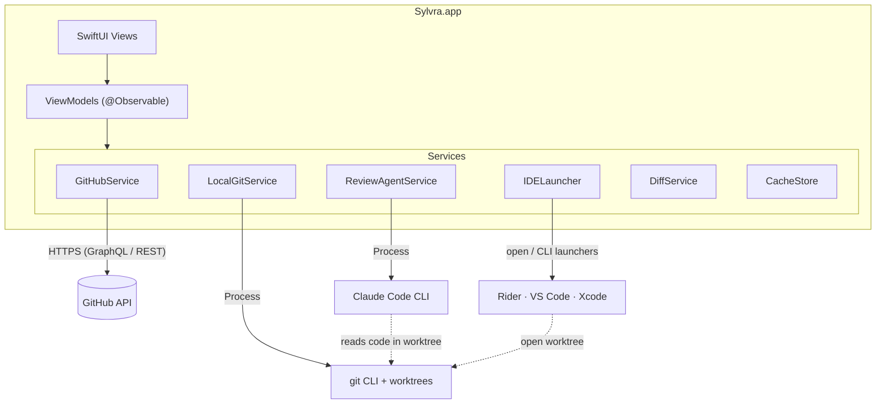
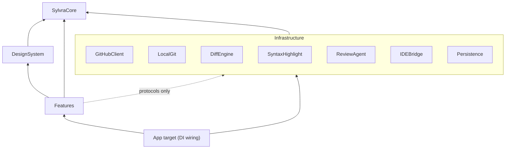
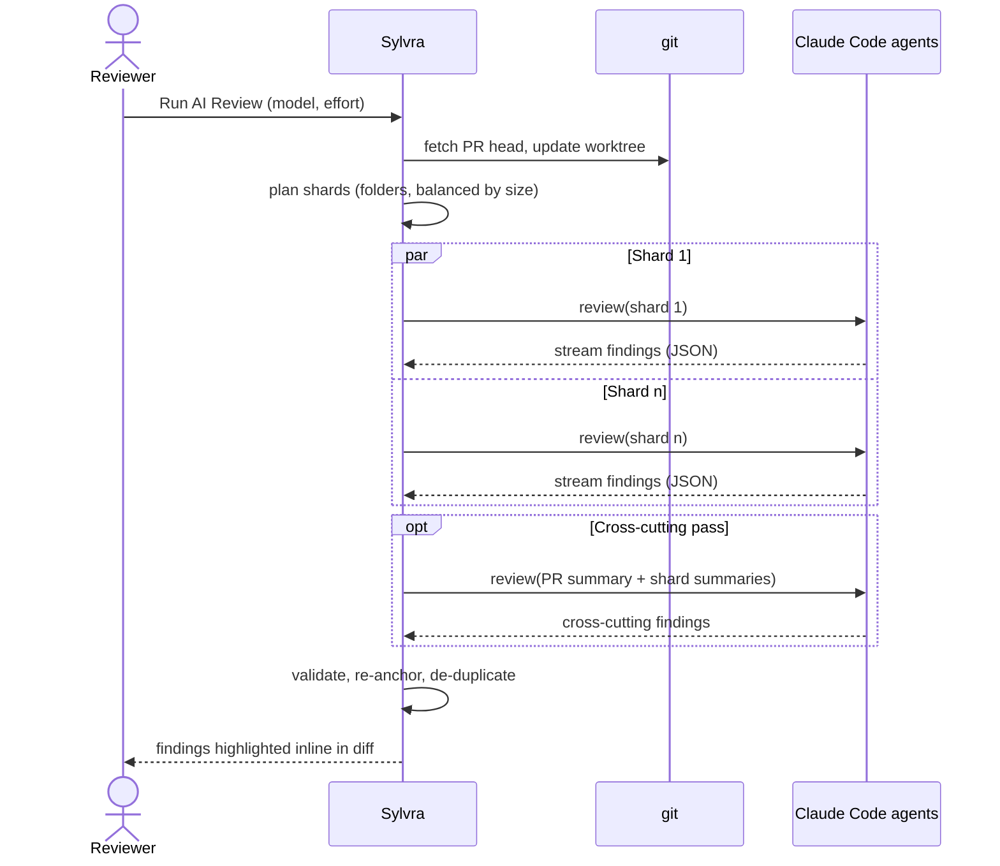
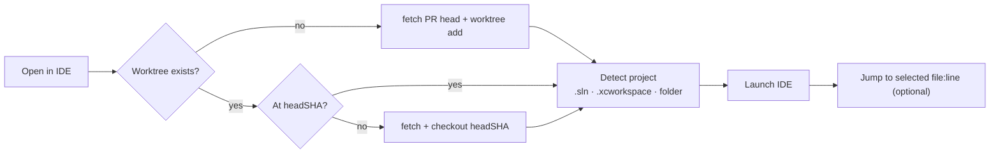

# Sylvra — Architecture

Status: **draft / target architecture**. The code base does not exist yet; this document describes the intended design and is updated as decisions are made.

## 1. Overview

Sylvra is a native macOS app (Swift, SwiftUI, AppKit where needed). It talks to three external systems, all from the user's machine:



There is **no Sylvra backend**. All data stays on the user's machine, except what is explicitly posted to GitHub.

## 2. Platform and tooling

| Topic | Decision |
|---|---|
| Language | Swift 6, strict concurrency checking enabled |
| UI | SwiftUI first; AppKit (`NSViewRepresentable`) for the diff text rendering and other performance-critical views |
| Minimum OS | Latest major macOS release (use current system materials, e.g. Liquid Glass) |
| State | Observation framework (`@Observable`), no Combine in new code |
| Concurrency | `async/await`, actors for shared mutable state, structured concurrency for parallel agents |
| Project layout | Xcode app target + local Swift package `SylvraKit` with multiple modules |
| Tests | Swift Testing (`import Testing`); XCTest only for UI tests |
| Distribution | Developer ID signed + notarized; Sparkle for updates (later). Not sandboxed initially (needs to run `git`, `claude`, IDE launchers) |
| Dependencies | Keep minimal. Candidates: SwiftTreeSitter (syntax highlighting), GRDB (SQLite cache), Sparkle (updates) |

## 3. Module structure (planned)

```
sylvra/
├── Sylvra.xcodeproj
├── App/                      # App target: entry point, scenes, windows, settings, DI wiring
├── Packages/SylvraKit/
│   ├── Package.swift
│   ├── Sources/
│   │   ├── SylvraCore/       # Domain models, protocols, shared utilities (no UI, no I/O)
│   │   ├── GitHubClient/     # GraphQL + REST client, auth, rate limiting, pagination
│   │   ├── LocalGit/         # git process wrapper, worktree management, local diffs
│   │   ├── DiffEngine/       # Diff parsing, hunk model, intra-line diff, moved-code detection
│   │   ├── SyntaxHighlight/  # tree-sitter based tokenization
│   │   ├── ReviewAgent/      # Claude Code integration: review runs, sharding, chat sessions
│   │   ├── IDEBridge/        # Detect and launch Rider / VS Code / Xcode
│   │   ├── Persistence/      # Cache (SQLite), settings, Keychain access
│   │   ├── DesignSystem/     # Colors, typography, AI highlight styles, reusable components
│   │   └── Features/         # Feature modules: Inbox, Essence, DiffViewer, Findings, Chat, Composer
│   └── Tests/                # One test target per module
├── specs/                    # Product and technical specs
└── AGENTS.md
```

Dependency rule: `SylvraCore` depends on nothing. Infrastructure modules (`GitHubClient`, `LocalGit`, `ReviewAgent`, `IDEBridge`, `Persistence`) depend only on `SylvraCore`. `Features` depends on core + infrastructure protocols. The `App` target wires concrete implementations together.



## 4. Domain model (core)

```swift
struct RepositoryRef      { owner, name, defaultBranch, localClonePath? }
struct PullRequest        { id, number, repo, title, body, author, state, isDraft,
                            baseRef, headRef, headSHA, baseSHA, labels, reviewRequests,
                            ciStatus, reviewDecision, additions, deletions, changedFiles,
                            updatedAt, lastViewedByMeAt? }
struct ChangedFile        { path, previousPath?, status, additions, deletions,
                            kind: .source | .test | .config | .generated | .lockfile | .asset | .docs,
                            viewed: Bool }
struct FileDiff           { file, hunks: [Hunk], isBinary }
struct Hunk               { oldRange, newRange, lines: [DiffLine] }
struct DiffLine           { kind: .context | .added | .removed, oldLine?, newLine?, text,
                            intraLineRanges }
struct ReviewThread       { id, path, line, side, isResolved, comments: [ReviewComment] }
struct ReviewFinding      { id, path, startLine, endLine, side, severity, category,
                            title, rationale, suggestion?, confidence, sourceAgent }
struct ReviewRun          { id, pr, headSHA, model, effort, shards, status, findings,
                            summary, startedAt, finishedAt, cost? }
```

`ChangedFile.kind` is derived by a `FileClassifier` (path patterns, `.gitattributes` `linguist-generated`, known lockfiles), configurable per repo.

## 5. GitHub integration

- **API**: GraphQL v4 for PR lists, PR details, review threads and review submission; REST v3 where GraphQL is missing or simpler (e.g. raw diffs, file contents, `viewed` state via GraphQL `markFileAsViewed`).
- **Authentication**: priority order
  1. Token from the GitHub CLI (`gh auth token`) if available,
  2. OAuth device flow with a Sylvra GitHub App / OAuth App.
  Tokens are stored in the **Keychain** only.
- **Inbox queries**: search API qualifiers such as `is:pr is:open review-requested:@me`, `team-review-requested:<org>/<team>`, `involves:@me`, plus configured watched repositories and path filters (CODEOWNERS-like rules evaluated locally).
- **Refresh**: no push channel for desktop apps → polling with conditional requests (`ETag` / `If-None-Match`), adaptive interval (faster when the app is active, slower in background), respecting rate limit headers.
- **Writing**:
  - Comments are collected in a **pending review** (`addPullRequestReview` + `addPullRequestReviewThread`), submitted with `submitPullRequestReview` (COMMENT / APPROVE / REQUEST_CHANGES).
  - Code suggestions are rendered into the comment body as ```` ```suggestion ```` blocks for the selected line range.
  - Every write is an explicit user action. AI findings are never posted automatically.

## 6. Local Git integration

Sylvra uses the **system `git` binary** via `Process` (wrapped in an `actor GitRunner`), not libgit2. This guarantees identical behavior to the user's setup (credentials, LFS, hooks config, SSH).

- **Repository mapping**: each GitHub repo can be mapped to an existing local clone (auto-detected by scanning configured folders and matching `remote.origin.url`). If none exists, Sylvra can create a bare cache clone in `~/Library/Application Support/Sylvra/repos/`.
- **PR checkout via worktrees**: `git fetch origin pull/<n>/head` → `git worktree add <sylvra-worktrees>/<repo>/pr-<n> <headSHA>`. The user's main working copy is **never** modified. Worktrees are updated on new pushes and cleaned up after the PR is closed (configurable retention).
- **Local diffs**: used for full-file mode, very large PRs (GitHub truncates diffs), "changes since last review" (`git diff <lastReviewedSHA>..<headSHA>`), and moved-code detection (`--color-moved` style analysis in `DiffEngine`).

## 7. Diff engine

- **Input**: unified diff (from GitHub or local git) + optionally both full file versions.
- **Model**: `FileDiff → [Hunk] → [DiffLine]` with stable line identities (path + side + line number) used for anchoring comments and AI findings.
- **Intra-line diff**: token/word-level diff (Myers on tokens) for modified line pairs.
- **Presentation modes** (pure view-model transforms on the same model):
  - side-by-side / inline,
  - focused (N context lines, expandable) / full file.
- **Syntax highlighting**: tree-sitter grammars, tokenized off the main thread, cached per blob SHA.
- **Rendering**: TextKit 2 based `NSTextView` (or custom `NSView` with line virtualization) hosted in SwiftUI. Required for smooth scrolling of 10k+ line diffs, custom line backgrounds and gutter decorations.
- **Decorations layer**: comments, AI findings and selection ranges are overlays keyed by line identity, independent of the diff text. AI highlights are drawn as gradient fills and/or gradient strokes (see `ux.md`).

## 8. AI review with Claude Code

### 8.1 Integration approach

Sylvra drives the **locally installed Claude Code CLI** in non-interactive (print) mode as a child process. It does not call the Anthropic API directly and never handles Anthropic credentials; it uses the user's existing Claude Code login and settings.

- Binary discovery: user setting → `$PATH` lookup via login shell → common install locations.
- **Capability detection** at startup (`claude --version`, `claude --help`): supported flags (model selection, effort, output format, structured output) are detected at runtime, so Sylvra adapts to the installed version instead of hardcoding assumptions.
- Working directory: the PR **worktree**, so the agent can read the full code base, not just the diff.
- Output: streaming JSON events, parsed incrementally for live progress in the UI.
- Permissions: review runs use a **read-only tool set** (read, grep, glob, `git diff/log/show`). No file edits, no network-side effects.

An alternative backend (Claude Agent SDK via a small bundled helper) is kept open behind the same protocol:

```swift
protocol ReviewAgentBackend: Sendable {
    func review(_ request: ReviewRequest) -> AsyncThrowingStream<ReviewEvent, Error>
    func chat(_ message: ChatMessage, session: ChatSession) -> AsyncThrowingStream<ChatEvent, Error>
}
```

### 8.2 Review request

A review request contains: PR metadata, base/head SHA, list of files in scope (shard), repository review guidelines (`AGENTS.md`, `CLAUDE.md`, `.github/` review instructions, Sylvra per-repo prompt), selected model and effort, and the required **output schema**.

### 8.3 Structured findings

The agent must return JSON conforming to a schema, e.g.:

```json
{
  "summary": "string",
  "findings": [{
    "path": "Sources/Billing/Invoice.swift",
    "startLine": 42, "endLine": 48, "side": "RIGHT",
    "severity": "critical | major | minor | nit",
    "category": "bug | security | performance | concurrency | design | tests | style",
    "title": "string",
    "rationale": "string (markdown)",
    "suggestion": "optional replacement code for startLine..endLine",
    "confidence": 0.0
  }]
}
```

Findings are **validated** against the actual diff: paths must exist, line ranges must be inside the file, ideally inside or near changed hunks. Invalid locations are re-anchored (nearest hunk) or flagged as "unanchored" instead of silently dropped.

### 8.4 Parallel agents (sharding)

For large PRs, review speed improves by running multiple agents concurrently:

1. **Shard planning**: group changed files by namespace/folder, balance by changed-line count, keep related files (source + its tests) together. Noise files (generated, lockfiles) are excluded by default.
2. **Execution**: one Claude Code process per shard, limited by `maxParallelAgents` (setting, default e.g. 3) using a `TaskGroup` with a concurrency limiter.
3. **Cross-cutting pass** (optional): one agent receives the PR summary + all shard summaries to catch issues spanning shards.
4. **Merge**: de-duplicate findings (same location + similar title), order by severity, attach `sourceAgent`.



Single-agent mode is used automatically when the PR is small (threshold configurable), as sharding has overhead.

### 8.5 Chat

- One chat session per PR, run in the PR worktree, resumable via the CLI's session mechanism.
- The initial context includes the PR description, file list and the latest review summary/findings.
- Answers containing `path:line` references are parsed into clickable links into the diff.

### 8.6 Persistence of AI results

Review runs and chat transcripts are stored locally, keyed by `(repo, pr, headSHA)`. When new commits are pushed, findings from older runs are shown as **outdated** (with best-effort line re-mapping via the diff between SHAs).

## 9. IDE integration

`IDEBridge` provides one protocol, three implementations:

| IDE | Detection | Open project | Open file at line |
|---|---|---|---|
| JetBrains Rider | Bundle ID / Toolbox install paths, `rider` launcher | `open -a "Rider" <worktree>` or launcher | launcher `--line <n> <file>` |
| Visual Studio Code | Bundle ID, `code` CLI | `code <worktree>` | `code --goto <file>:<line>:<col>` |
| Xcode | Bundle ID, `xed` | `xed <worktree or .xcodeproj/.xcworkspace>` | `xed --line <n> <file>` |



## 10. Persistence

| Data | Storage |
|---|---|
| GitHub tokens | Keychain |
| User settings | `UserDefaults` / `@AppStorage` (non-secret) |
| PR cache, review runs, findings, chat transcripts, viewed state, last-reviewed SHA | SQLite (GRDB) in Application Support |
| Worktrees, cache clones | `~/Library/Application Support/Sylvra/` (configurable) |
| Syntax token cache | In-memory LRU + on-disk cache keyed by blob SHA |

## 11. Security and privacy

- No telemetry by default. No third-party analytics.
- Tokens only in Keychain; never logged.
- Code is only sent to Anthropic via the user's own Claude Code installation, and only when an AI review or chat is explicitly started.
- AI agents run with read-only tools in an isolated worktree.
- All `Process` invocations use argument arrays (no shell string interpolation) to avoid injection via branch names or paths.

## 12. Performance targets

- Inbox visible from cache in < 300 ms after launch; refreshed in background.
- PR essence (change map + file list) in < 1 s for typical PRs.
- Diff view: 60/120 fps scrolling for files with 10k+ lines.
- Main thread never blocks on I/O, git, or agent processes.

## 13. Open questions

- GitHub App vs. OAuth App for the device flow (fine-grained permissions vs. simplicity).
- Exact Claude Code CLI flags for effort and structured output across versions — resolved via runtime capability detection.
- GitHub Enterprise Server support timing.
- App Sandbox feasibility for Mac App Store distribution (likely not, due to process spawning).
