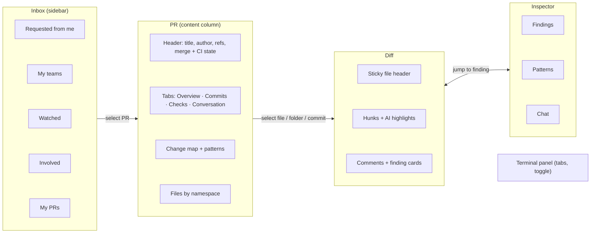
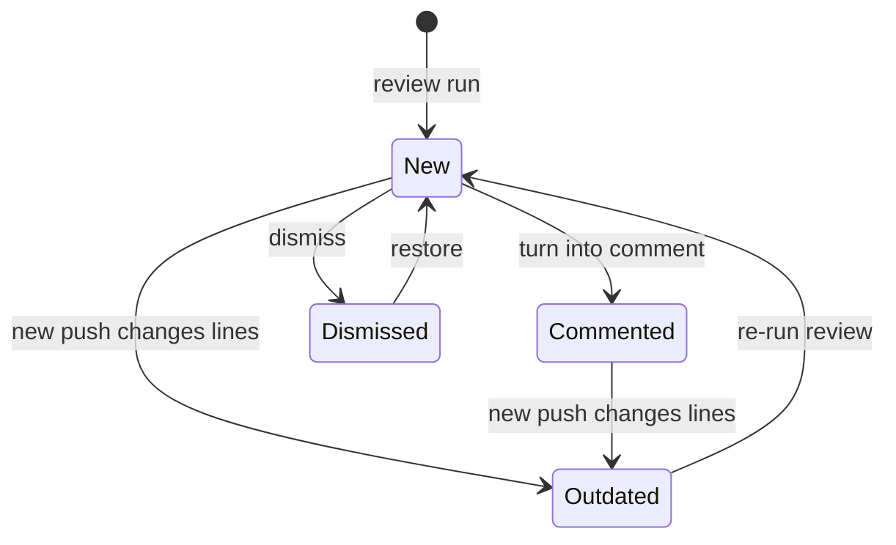

# Sylvra — UX

## 1. Design intent

**A quiet place for focused work — and reviews that are fun again.**

The interface steps back so the code and its essence come forward. Sylvra should feel beautiful and practical every single day, not only on first launch. Every design decision is checked against one question: *does this make reviewing lighter and more enjoyable?*

- **Calm**: generous spacing, restrained color, no visual noise.
- **Clarity**: every screen answers one question first ("What changed?", "Where is the risk?", "What did the AI find?", "What patterns are used or missed?").
- **Precision**: crisp typography, monospaced code, exact alignment in diffs.
- **Wow where it matters**: the diff view is the showpiece (§6).
- **Alive, not busy**: micro-animations that explain state changes (§3).
- **Native**: follows Apple's Human Interface Guidelines (§2).

## 2. Apple HIG and deviations

Sylvra follows the **Human Interface Guidelines** by default: sidebar / content / inspector layout, toolbar, menus and keyboard shortcuts, system materials (Liquid Glass), SF Symbols, standard controls, Settings window, notifications.

We deviate **only with a clearly documented reason**. Every deviation is listed here:

| Deviation | Why |
|---|---|
| Custom-rendered diff view instead of standard text views | Core differentiator: performance on huge diffs, gradient AI highlights, connector ribbons and animations are impossible with standard controls. |
| Brand colors (violet / gold) beyond the system accent color | Recognizability and the calm, premium mood derived from the app icon. The user's system accent color is still respected for standard controls (selection, focus rings) where possible; the diff's code selection is outlined in brand violet so it reads on the code surface and matches the AI accents. |
| Multi-hue AI gradient | AI-generated content must be instantly recognizable and never confused with human content. |
| Review shortcuts with modifiers (`⌘]`, `⌥⌘↓`, `⌥⌘V`) instead of single letters (`]`, `J`, `V`) | Single-letter menu shortcuts would fire while typing in the comment composer and the chat. |
| *Compact* layout: inbox and pull request share one column with a `‹ Inbox` back button (drill-down) instead of a sidebar | On a laptop the diff needs the width, and while reviewing the other PRs should stay out of sight; the inbox is one click away and the same pattern already opens a repository inside the inbox. |
| Own *About Sylvra* window instead of the standard About panel | The standard panel's plain credits text fell far behind the rest of the app; the window keeps its content (name, version, copyright, credits) and adds the license texts of bundled open-source software. |
| Overlay scroll bars unless System Settings says "Always" (`ScrollerPreference`, this launch only) | With a mouse, "Automatically" shows legacy scroll bars that take width; they came and went with content height and window focus, so column content got narrower and wider and truncated text jumped. |

## 3. Visual language

### 3.1 Color system (derived from the app icon)

Hex values are sRGB approximations of the Display P3 values used in `App/AppIcon.icon`. Code: `DesignSystem/SylvraColor`; system accent color: `App/Assets.xcassets/AccentColor`.

| Token | Role | Light | Dark | Icon source |
|---|---|---|---|---|
| `brandPrimary` | Primary brand color: key actions, active states, brand surfaces | `#6C48C6` Sylvra Violet | `#B39AF2` Lavender | Leaf gradient (deep / mid) |
| `brandSecondary` | Secondary surfaces, selected rows, subtle fills, charts | `#B39AF2` Lavender | `#4B2A8A` Royal Violet | Leaf mid / background top |
| `brandTint` | Very light tints, hover backgrounds, empty states | `#EADFFF` Lavender Mist | `#2D1857` Deep Violet | Leaf highlight / dark background top |
| `accentGold` | Accent: focus of attention — selected finding border, primary call to action highlight, "new" markers | `#E2B44F` Gold | `#F7DC86` Light Gold | Veins |
| `accentGoldSoft` | Gold glow, specular highlights in animations | `#FFF1BF` Champagne | `#FFF1BF` Champagne | Vein tip |
| `canvasDeep` | Brand backgrounds (splash, empty states, onboarding), dark window tint | `#170A33` Aubergine | `#0B051A` Night Violet | Icon background bottom (light / dark) |

Rules:

- **Neutrals** (window, text, separators) come from the system semantic colors; the brand colors are used sparingly on top.
- **Gold is precious**: at most one gold-accented element in focus at a time.
- **Diff colors** are *not* brand colors: low-saturation green/red backgrounds, stronger tint only for intra-line changes. A color-blind-safe alternative (blue/orange) is available in settings.
- **Severity colors** are muted, never neon.
- **AI accent**: a subtle multi-hue gradient (violet → indigo → teal), reserved **exclusively** for AI-generated content.
- All tokens live in `DesignSystem` (asset catalog color sets with light/dark variants). Feature code never uses hardcoded colors.

### 3.2 Appearance

- **Auto / Light / Dark**: follows the system appearance by default; can be overridden in settings.
- Both appearances are designed with equal care; the dark appearance is not just "inverted".

### 3.3 Typography and iconography

- SF Pro for UI, SF Mono (configurable) for code. Clear hierarchy, few sizes.
- SF Symbols, consistent weight.
- **Avatars**: user avatars from GitHub wherever a person appears (inbox rows, PR header, commits, reviewers, comments), circular, with initials as fallback.

### 3.4 Motion and micro-animations

Animations are used where they **help to understand** what happens — never as decoration. Short, spring-based, interruptible; respect "Reduce Motion".

Examples:

- Selecting a folder in the change map: the treemap tile zooms smoothly into the file list.
- Expanding hidden context in the diff: lines unfold from the separator.
- A new AI finding appears: its gradient highlight fades in on the code, the gutter marker pops gently.
- Marking a file as viewed: the checkmark draws itself, the review progress bar advances.
- Resolving a thread: it collapses into a slim "resolved" line.
- AI review running: a soft shimmer travels along the activity indicator and the files being reviewed.
- Copying a SHA: a brief "Copied" morph of the button.

## 4. Window layout

A three-column `NavigationSplitView` plus an optional inspector and a bottom terminal panel.

Toolbar (like Fork: the pull request in the middle, buttons split by purpose):
`[Sidebar] [⟳] [Changes ▾] [Commits ▾] [▥|☰]   ( repo · #1234 · Title / head → base · 1 of 2 approvals · 1 check failing )   [Open in ▾] [>_ ▾] [✦ AI Review ▾] [Submit review 1]  [activity] [layout ▾] [AI panel]`

- **Left — what you see**: sidebar, refresh, which changes (scope, commit by commit) and how (side by side / inline).
- **Middle — what it is about**: a glass box with gently rounded corners. Its width grows in steps with the window (400 / 560 / 720 / 880 pt from 0 / 1760 / 2000 / 2300 pt window width, 40 pt hysteresis) and stays constant within a step, so AppKit never sees it change during a layout pass. Repository and number chips open GitHub; the title is one line; the status line shows head → base, the approvals (jumps to the Overview tab) and the checks (jumps to the Checks tab). Empty box space drags and zooms the window.
- **Right — what you do**: open in IDE, terminal, AI review and *Submit review* as the one prominent button, then the window controls (background activity, window layout, AI panel).

The repository and `#1234` in the middle box are chip buttons (light rounded background, no underline) that open the repository and the pull request on GitHub. Double-clicking empty title bar or toolbar space zooms or minimizes the window as set in System Settings, also where SwiftUI's toolbar background would swallow the click.



- **Sidebar (Inbox)** — which PRs need my attention.
- **PR column** — everything about the PR and where it changed.
- **Diff** — the code.
- **Inspector** — AI findings, patterns, chat, as tabs that look and narrow like the pull request column's (symbol, name, count badge — findings, patterns, chats with messages; the shared `SectionTabBar`). Its header (run status) and tabs stay fixed; only the tab content scrolls. After a run the header shows when it ran and *Run again*; the result remembers the head commit it saw, and when the pull request got new commits since, an orange hint ("New commits since this review") offers *Run again* prominently (the toolbar button's help says so too). A new run loads the current diff.
- **Window layouts** — toolbar menu on the left next to the diff layout (column-diagram symbol of the active layout, with a chevron) and ⌃⌘0–4: *Automatic* (compact below 1700 pt window width, wide otherwise; decided from the remembered window size or the screen before the window is measured, so a laptop doesn't start wide and switch), *Wide* (all columns side by side), *Compact* (laptops: one column + diff — a two-column split view without an inbox sidebar; the inbox and the pull request share that column like a navigation stack — the inbox is the top level, picking a PR opens it in its place, `‹ Inbox` at the top left or ⌘0 goes back, so the other PRs stay out of sight while reviewing; the AI inspector floats on the right and a click into the diff puts it away (it covers much of the right half of a side-by-side diff on a laptop); picking a finding — in the panel, with ✦ in the diff or with next/previous finding — closes it too and shows the finding's card in the diff, and comment composers, threads and finding cards in the diff keep clear of it so their text and buttons stay visible — as far as they stay at least 420 pt wide; in a narrow side-by-side half they keep that width and run underneath the panel instead of being squeezed), *Focus* (diff and AI sidebar only, changed files in a toolbar popover), *Two windows* (for two screens: inbox and pull request in the main window, diff, AI and terminal in a second "Sylvra Review" window; both always show the same pull request, single-key shortcuts act on the review window).
- **Remembered per screen setup** — the window layout, the column widths (inbox, pull request, AI inspector) and the frames of the main and review windows are saved per combination of connected screens (e.g. laptop only, 34", 49", two 27"; by screen name and size, not arrangement). When the screens change, Sylvra waits until they are stable and restores that setup's layout; nothing is saved while macOS rearranges the windows. Only widths the reviewer drags are saved: not while the window is placed at launch or restored, resized (the split view squeezes the columns, often to their minimum) or rearranged, and never by demo launches. A new setup starts with the last column widths and keeps the current layout. Settings, the diagnostic log and other windows keep AppKit's frame memory.
- **Panel handles** — the inbox and the AI panel collapse and expand with a small tab on their edge, the same in every layout (no toolbar buttons; *Compact* has no inbox handle, see above): both sit inside their panel while it is open — the inbox handle on the inbox's right edge (docked or floating), the AI handle on the panel's left edge — and on the edge of the neighbouring column while it is closed: the inbox handle on the left edge of the pull request column (of the diff in *Focus*), the AI handle on the right edge of the diff. At rest a quiet sliver (white in light mode, a lighter violet in dark mode so it stands out from the dark surfaces) with a light brand edge and a chevron pointing where the panel will move; on hover it pulls out and takes the brand tint. The handle of a closed inbox is filled with the brand violet at rest, so the way back to the other PRs is easy to find. ⌘0 toggles the inbox, ⌥⌘I or `i` the AI panel.
- **Terminal panel** — bottom panel, toggle with ⌃\`.
- **Commands panel** — shares the bottom panel (⌥⌘K, or *Commands* in the terminal header): every GitHub request (GraphQL operation or REST path, variables, status, duration, JSON preview) and every command (git, gh, agent CLIs) of the session, newest first, filterable, failures in red. In memory only; tokens never appear, diffs, file contents and agent output only as their size.

Columns are collapsible. *Focus mode* (⌃⌘F) hides sidebar and PR column for maximum diff space.

### 4.1 View naming (implementation)

Screens follow the container / presentational split described in `architecture.md` §3.3: `InboxScreen`, `PullRequestScreen`, `DiffScreen`, `SettingsScreen`; regions as `FindingsInspector`, `TerminalPanel`, `SubmitReviewSheet`; pure building blocks as `*View`, `*Row`, `*Badge`.

## 5. Inbox (sidebar)

**Sections** (collapsible, with count):

1. *Requested from me* — direct review requests.
2. *My teams* — team review requests and CODEOWNERS matches (most reviews are not assigned personally).
3. *Watched* — open PRs in watched repositories / paths.
4. *Involved* — mentioned, commented, previously reviewed.
5. *My PRs* — my own open PRs.
6. *Recently closed* — last 7 days.

**Inbox and repositories** (like Mail: what needs me, then where I work):

- The *inbox sections* above group pull requests by *why* they concern the user (review requested, team, involved, mine).
- Below them, **Repositories** lists the repositories the user added (6–8 typically), each with its number of open pull requests. Clicking one replaces the sidebar content with *all* open pull requests of that repository, grouped into *Waiting for you*, *Yours* and *Open*; `‹ Inbox` or Esc goes back. The search field then searches on GitHub (debounced), and pages load while scrolling (*Load more*), so huge repositories (monoliths with hundreds of open PRs) stay usable.
- Repositories are added with a search sheet (e.g. `org:acme billing`) or from repositories already in the inbox. *My teams*, *Involved* and *Recently closed* only search the added repositories; *Requested from me* and *My PRs* always search all repositories so nothing addressed to the user is missed. Reason: one broad search over a large organization can exceed GitHub's time limit (502).
- Sections are collapsible; the state is remembered.
- **Waiting on others**: a PR where the user acted last (review, comment, reply) is dimmed with an hourglass and grouped below the others until someone else adds a comment, review or commit; then it shows *New activity*. Rows show `#number` in the brand color and a comment count bubble.

**Why you're involved**: the PR overview shows where the user was @-mentioned (description, comments, reviews, code comments with file and line; excerpt with the mention highlighted, link to GitHub) and how often they commented — so *Involved* PRs explain themselves. With new activity since the user's last comment or review, the card lists what is new: commits (SHA, subject, author) and comments, reviews and replies by others (author, place, excerpt), newest first, each opening on GitHub; bots are left out.

**Filters** (inbox and repository view): chips above the list — *Filters* menu with persistent preferences (hide bots, hide drafts by others — own drafts always stay visible, hidden authors), *Author*, *Needs review*, *CI failing*, *Small*. Right-click a pull request: *Show only PRs by …*, *Hide PRs by …*. A hint counts what the filters hide.

If GitHub reports `X-GitHub-SSO: partial-results`, the sidebar explains that the GitHub CLI token isn't authorized for an organization's single sign-on.

**PR row**:

```
 (avatar) ◉  Add invoice export                          2h
             owner/repo #1234 · +340 −52 · ✓ CI · ⇄ mergeable · ⟳ updated
```

- Status dot: unread / updated since my last review / reviewed.
- Badges only for meaningful states: draft, conflicts, CI failing, blocked, *AI-authored*, *changes since my review*.
- Search (title, number, author, branch) and filter chips (see above).
- **Stacks**: the layers of a stack stay together in a section, bottom first, where the first of them would be; each row shows `⧉ 2/4`. GitHub's stacks come from a separate small query (the inbox still loads if it fails); for other stacks the listed pull requests are linked by their branches (base = another one's head, same author, one candidate on each branch) and the badge shows only the symbol, since layers outside the inbox are unknown.

## 6. PR column

### 6.1 Header

Title, author avatar and name, `head → base` refs (with fork owner), merge state chip, CI chip, review decision, age. Actions: *Open on GitHub*, *Copy link*, *Open in IDE*.

**Stacks** (pull requests that build on each other): below the header a slim bar shows *Stack · 2 of 4* — a menu with all layers (top first like on GitHub, the base branch at the bottom; picking one opens it, also when the inbox doesn't list it) — and the layers below and above as `↓ #1233` / `#1235 ↑`. Beneath it, what the reviewer should know: *Builds on #1233, which isn't merged yet*, or in gold when the branch misses commits of the layer below (*#1233 has 3 commits this branch doesn't include yet: the diff doesn't show its latest state* — a restack is due). Stacks come from GitHub (`gh stack`, github.com) or, for any other tool, from the branches: the layer below is the only open pull request whose head is this one's base, the layer above the only one targeting this one's head; branches several pull requests target (`develop`, release branches) end the chain.

### 6.2 Tabs

| Tab | Content |
|---|---|
| **Overview** | **change map** at the top · description rendered as Markdown like AI chat answers (plus GitHub extras: template comments hidden, task lists as ☐/☑, `<details>`/`<summary>` text kept, images as links) · labels, assignees, milestone, linked issues · reviewers with state and avatars, above them **where the approvals stand** ("1 of 2 approvals" with dots; still missing: more approvals, code owners — marked with a shield —, who is still asked, requested changes; the required count comes from the base branch's rulesets and branch protection and is shown as unknown when not visible) · **merge status** in plain words ("Blocked: 1 more approval needed (1 of 2), code owner review needed: @acme/billing, 1 check failing") · change map · patterns · files by namespace |
| **Commits** | Commit list: avatar, subject, short SHA (click = copy, ⌥-click = copy full SHA), author / committer, date, verified badge, CI state. Expand for full message body. Select a commit to review it on its own in the diff (*All changes* goes back); the diff shows a banner with ◀ ▶ and `⌥]` / `⌥[`. Review threads, AI findings and new comments refer to the whole PR's line numbers, so they are hidden while a single commit is shown. *Open commit on GitHub*. |
| **Checks** | All checks with status, duration and result; failing ones on top. **A click shows what the check reported** (GitHub's *Summary*: title, summary, annotations with file and line, details); the arrow opens the run on GitHub (build logs). Re-run is done on GitHub. |
| **Files** | Changed files by folder (tree or list) with tools per file and folder. |
| **Comments** | Sections *Conversation · Code · Unresolved*. **Conversation** works like GitHub's PR conversation, oldest first: comments and review summaries (approvals without text as a slim line), reactions, *Quote reply* (conversation comments have no threads), edit and delete own comments (with confirmation), a Markdown field with preview and tone check (*Comment*, ⌘↩, posts right away). Reloads every minute while shown, plus a refresh button. **Code** / **Unresolved** list the code threads (latest activity first, *Resolved* / *Outdated* chips); each has *Show in diff* (jumps to the line, where threads are answered) and *Resolve* / *Unresolve* (shown at once, undone if GitHub refuses; the thread in the diff follows, and resolving there updates this list). |

All tabs stay visible side by side (⌘1–⌘5) with their counts as small badges (violet on the selected tab); while checks fail, the checks tab shows a red warning symbol and its badge turns red and counts the failing ones. Narrower columns use smaller text, then symbols with only the selected tab named, then symbols only (names in tooltips) — never a menu.

### 6.3 Change essence

1. **AI summary** — 2–4 sentences: intent, scope, risk areas, relation to earlier changes. Marked with the AI accent. Shown in the PR column **above the tabs** (pinned with the header, collapsed to 3 lines, *More* expands; the reading order folds out below), so it stays visible during the whole review.
2. **Change map** — treemap of namespaces/folders (area = changed lines, color intensity = add/delete ratio, soft AI glow where findings are). Alternatives: sunburst, indented tree with sparkline bars. Click filters files and diff.
3. **Patterns — "What patterns are used or missed?"** — compact list: pattern name, verdict chip (*followed* · *violated* · *introduced*), one-line rationale; click highlights the evidence in the diff.
4. **Files by namespace** — tree grouped by folder, with +/−, kind icon, viewed checkmark, finding/comment counts. Noise group collapsed at the bottom. Optional AI reading order.
5. **Review progress** — "12 of 18 files viewed".

**Viewed / not viewed** is a manual, per-file toggle — always under the reviewer's control:

- Checkbox on every file row in the file list and in every sticky file header in the diff; shortcut `V`.
- Clicking the file name in a sticky file header offers *Copy Path* and *Copy File Name*.
- Context menu: *Mark as viewed* / *Mark as not viewed*; on folders: *Mark all as viewed / not viewed*.
- Marking a file as viewed in its diff header collapses it and scrolls the diff to the header of the next file still to review (the next file below that isn't viewed yet), which also becomes the selected file.
- Synced with GitHub's "Viewed" state in both directions.
- **New pushes**: Sylvra checks for a new head commit every minute while a pull request is open and then reloads it right away — details, file list, commits, checks and the diff. Only while a comment is being written does a banner ("New commits were pushed") offer *Refresh* instead, so the composer keeps its lines.
- When a viewed file changes in a new push, it automatically flips back to *not viewed* and shows a "changed since viewed" marker (like GitHub).
- Viewed state is per file for the whole PR (GitHub has no per-commit viewed state); commit-by-commit mode shows the same toggles.

## 7. Diff view — the *wow* view

The diff must feel like the best diff one has ever used: fast, beautiful and instantly understandable.

### 7.1 Modes

- **Layout**: `Side by side` | `Inline` (⌘⌥1 / ⌘⌥2); remembered per pull request across AI reviews and launches (a pull request without a choice starts with the last one made); a pull request's choice is forgotten once it is merged or closed (checked at launch) or after a week without opening it
- **Scope**: `Focused` (changed hunks + N context lines, N ∈ {3, 5, 10, custom}) | `Full file` (only the selected file, every line of its head version; choosing another file in the navigator, `[`/`]` or a jump shows that one; each file loads when first shown, with a *Loading…* badge over the diff, also while *Since my last review* loads)
- **Range**: `All changes` | `Since my last review` | `Commit…` (commit-by-commit, with ◀ ▶ to step through commits; toolbar menu and Commits tab) | custom range (later)
- **Since my last review after a rebase** (e.g. a restacked layer of a stack): when the branch was force-pushed after the reviewer's last review, comparing with the reviewed commit also shows what the rebase brought in from below. Files the pull request itself doesn't change are left out, and a gold note says how many and that files the pull request changes can still contain changes from below (separating those lines would need a `git range-diff`; not done yet).
- Toggles: hide whitespace, wrap lines, show moved code.

### 7.2 Wow elements

- **Connector ribbons** (side by side): smooth, softly tinted curves connect each changed region on the left with its counterpart on the right, flowing while scrolling.
- **Intra-line highlights** with a gentle glow on the changed tokens.
- **Animated context expansion**: "⋯ 24 unchanged lines ⋯" unfolds smoothly (a small spinner replaces the buttons while the file loads for the first expansion).
- **Focus lens**: unchanged code is slightly dimmed in focused mode; the change is in the light.
- **Moved code** shown with a neutral tint and an animated link to its origin.
- **Overview ruler / minimap** with a heat strip of changes, comments and AI findings; click to jump.
- **Sticky file and scope headers** (current type / function).
- **120 fps** scrolling, even on huge files.

### 7.3 AI highlights (Xcode-style)

- **Finding box**: a rounded box around the affected lines with a border in the AI gradient (violet on the left to teal on the right; gold for the *selected* finding) and a soft glow along its edges that fades towards the middle, so added and removed lines keep their green and red. Border and glow strength scale with severity; ✦ in the gutter of the first line and an AI badge on the box's top right edge.
- **Select code**: dragging over the code selects it across lines, from a column to a column like in an editor (side by side: within one version); held at the top or bottom edge or beyond, the diff scrolls on and the selection grows with it, faster the further out. The selection is a translucent brand-violet fill with a 1 pt violet outline around the whole shape, like an editor's: the first line from its column to the right edge, full lines in between, the last line up to its column; rows join without gaps, and a hunk header closes the shape. On the selection's last line sit *Ask AI* (opens the chat with the file, the lines and the selected code as context; the reviewer writes the question, nothing is sent or posted before) and *Copy*; ⌘C copies it too (a text field being edited or text selected elsewhere, e.g. in the chat, keeps its own ⌘C); a click into the code clears the selection.
- **Copy code**: *Copy* next to a selection; right-click a diff line for *Copy Line* (side by side: new / old line), *Copy Hunk* (new or old version) and *Copy Hunk as Diff* (with `+`/`-` prefixes).
- **Risk**: every finding carries *impact* (how bad if it happens) and *likelihood* (how likely in practice), each low / medium / high, shown under its title in the inspector and the inline card. The review also rates the pull request as a whole (*Risk: Low / Medium / High* badge in the AI summary, reasons when expanded and in the tooltip); with several shards or models the highest rating wins.
- **Clicking a highlighted line** (code area or the gutter ✦; the line numbers keep their comment action; dragging still selects text) selects that finding: its inline card opens below the lines and the inspector switches to it.
- **Inline finding card**: title, severity, category, models that found it, rationale, suggested code as mini-diff; actions *Turn into comment*, *Dismiss*, *Ask in chat*, *Open in IDE*.
- **Pattern evidence**: a subtle dotted underline in the AI accent; hover shows the pattern name and verdict.
- Setting: *Background*, *Border*, or *Both*.

### 7.4 Threads in the diff

Existing threads inline (collapsible) with reply, resolve / unresolve, reactions, edit / delete own comments, *Open on GitHub*. Outdated threads are marked and collapsed.

## 8. Commenting

- Hover a line → `+` in the gutter; drag for a range; or `C`.
- **Open in IDE at a line**: hovering a line also shows an open-in-IDE button next to `+` in the gutter, and the line's right-click menu starts with *Open in <IDE> at Line n*. It opens the pull request's worktree in the preferred IDE at that line of the head version; a removed line opens where it was (the next line that still exists). In single-commit view the line numbers are the commit's, so the IDE may be off by the later commits' changes.
- **Composer**: Markdown with preview; **Insert suggestion** (⌘⇧S) pre-fills a ```` ```suggestion ```` block with the selected lines and shows a live mini-diff; *Add to review* (pending) or *Comment now*.
- **From AI finding**: *Turn into comment* prefills title, rationale and suggestion in the **comment language** (default English), editable. The reviewer owns the comment; no automatic "AI" label.
- **Pending review** counter in the toolbar. *Submit* opens a sheet: summary, *Comment / Approve / Request changes*, list of pending comments.

## 9. AI review flow

**Toolbar button** `✦ AI Review` with a menu:

```
✦ AI Review  ▾
  ─────────────────────────────────────
  Agent:   [ Claude Code ▾ ]
  Models:  [✓ Opus] [  Fable] [  …]       (multi-select)
  Effort:  [ Low | Medium | High ]
  Agents:  [ Auto (3) ▾ ]
  Scope:   ( ) Whole PR  ( ) Since last review  ( ) Commit…  ( ) Selected files
  ─────────────────────────────────────
  Context: AGENTS.md ✓ · CLAUDE.md ✓ · specs/ ✓ · history ✓
  [ Save as default for this PR ]
```

- Single click runs with the PR's settings (or the global defaults).
- **Progress** in the inspector: before the agents start, the step being prepared ("Loading the diff…", "Checking out the pull request…", "Reading the project's guidelines…"); then one row per agent / shard / model, streaming status, elapsed time, cancel. The toolbar activity indicator gives the overview ("AI review · billing #881", "2 of 3 agents", a button opens that pull request); the inspector has the detail.
- **One review at a time.** The inspector header always offers the next step: *Run AI Review* before the first review, *Run again* after it, *Cancel* while it runs. While a review runs for another pull request, the header says which one (with its progress), and offers *Show* and *Stop It and Review This One*.
- The tabs **Findings · Patterns · Chat** are always shown for a selected pull request: the chat works without a review; findings and patterns say "No AI review yet" until there is one (no count badge then).
- Findings and patterns appear **live** as shards complete.
- **Findings list**: grouped by severity or file; filter by category or model; `J`/`K` next/previous, `↩` jump, `D` dismiss, `C` turn into comment.
- **Whole pull request**: above the findings, a card with points about the change as a whole (*Could be simpler*, *Too much code*, *Too scattered*), when the agents found any.
- **Patterns list**: followed / violated / introduced, with evidence links. Clicking a pattern selects it and jumps to its first evidence; the selected pattern's evidence is marked in the diff like a selected finding, violated patterns are always marked lightly. Clicking such a mark in the diff selects the pattern in the Patterns tab.
- **History**: references to earlier commits / PRs the AI related the change to (clickable, open on GitHub).
- **Copy for an agent**: the AI summary, the *Whole pull request* card, every finding (in the list, expanded and as the card in the diff), every pattern and every chat message have a small copy button (two squares, a checkmark for a moment after copying) and *Copy* in their right-click menu; *Copy all findings*, *Copy all patterns* and *Copy the whole chat* copy the lists. The text is Markdown meant to be pasted into a coding agent (e.g. Claude Code in a terminal): the pull request (`owner/repo#number — title`), full paths with lines, severity, category, impact and likelihood spelled out, suggestions as code blocks in the file's language, chat turns marked *Me* / *AI*. Copied labels stay English (agents and prompts are English), the AI's own text keeps its language.
- Previous runs selectable (models, effort, SHA, duration).



## 10. Chat

- Inspector tab *Chat* or floating panel (⌘⇧K).
- While an answer is on its way: a pulsing sparkle in a turning ring of the AI colors, a shimmering status that changes every few seconds ("Reading the diff…", "Weighing edge cases…") and, after 3 s, the time waited; still with Reduce Motion (the status keeps changing).
- Context chips: PR, current file, selected lines, selected finding, current commit — removable.
- Answers in the configured **agent language** (e.g. German), rendered Markdown (headings, nested lists, fenced code, quotes, rules, tables with aligned columns; long code lines wrap), clickable `path:line` references. The reviewer's own messages stay plain.
- The chat follows new messages: an answer is scrolled to its first line, a sent question to the end, and opening the tab shows the end. Scrolled up, a round ↓ button floats at the bottom centre and jumps to the latest message.
- Questions are bubbles on the right; answers use the full width with the AI accent border. Round send button (⌘↩).
- Below the input two small menus choose the **model** and **effort** of the next question (per PR; defaults to the PR's AI review settings).
- **Several chats per PR**: *New chat* starts a fresh agent conversation; the earlier chats stay in a menu above the chat (titled by their first question) and continue where they left off. *Ask in chat* on a finding opens its own chat unless the current one is about that finding or still empty; *Discuss* on other code does the same.
- **Ask AI on a review thread** asks about the discussion; an answer with a *Suggested reply:* section can fill the thread's reply field.
- Quick prompts: *Explain this change*, *Is this tested?*, *What could break?*, *Which patterns does this follow?*, *Summarize discussion*.

## 11. Open in IDE

- Toolbar `Open in ▾`: primary action = repo default; menu = all detected IDEs (Rider, VS Code, Xcode, default app) — e.g. open a VS Code project in Rider.
- Second menu level / modifier: **Worktree** (default) or **Main clone**. Choice can be remembered per repo.
- Context menu on files and lines: *Open in Rider at line 42*.
- Feedback: activity indicator "Preparing worktree…" → toast "Opened in Rider".
- If the main clone has uncommitted changes: a sheet explains the situation and offers *Stash and continue* / *Cancel*.

## 12. Terminal and custom tools

- **Terminal panel** at the bottom (⌃\`), tabs with one or more sessions, starting in the PR worktree / clone; *New tab*, *Open in external terminal*.
- **Custom tools** in the context menu of files, folders and the PR ("Tools ▸ Run tests", "Tools ▸ Open in Fork") and in the command palette; output in a terminal tab or as a background job.

## 13. Background activity and notifications

- **Activity indicator** in the toolbar whenever something runs in the background; its help names the jobs, a click opens a popover with all jobs (name with the pull request, progress; a job on a pull request opens it).
- **macOS notification** when a job finishes while Sylvra is not focused, e.g. "AI review of #1234 finished — 2 major, 5 minor". Configurable per job type in settings.
- **Replies**: new comments by others on a PR the user is involved in raise a notification; clicking it opens the PR. Open PRs reload their review threads every 60 s and only redraw when something changed.

### 13.0 About

*Sylvra → About Sylvra* opens Sylvra's own About window instead of the standard panel (deviation, §2: the standard panel's plain credits text fell far behind the rest of the app). Fixed size, no title bar, on a brand canvas like a splash (dark: deep violet with lavender glows; light: pale lavender with violet ink, violet labels instead of gold for contrast) with a violet glow behind the large app icon; the glows drift slowly (still with Reduce Motion). It shows the name, the tagline, the version as type alone (large, thin figures, the build number below), *View on GitHub* (`github.com/mduu/sylvra`) and *Check for Updates*. Below, *Open source* lists the software Sylvra ships with (today SwiftTerm, MIT) as cards: name, purpose, license chip; a click unfolds the full license text and the project link. The footer names the author (*Made by Marc Dürst*) above the copyright and a link to Sylvra's MIT License. *Help → Sylvra on GitHub* opens the project page. The About window and the review window of the two-window layout are not listed in the Window menu (`commandsRemoved`): About is in the Sylvra menu, the review window is opened by its layout and the toolbar's *Review window* button. A new bundled dependency gets an entry in `Acknowledgement.all` (`FeatureUpdates`).

### 13.1 Updates

Sylvra updates itself from the GitHub Releases of `mduu/sylvra` (no Sparkle, no appcast; see architecture §14.3).

- **When**: at launch and every 6 hours, silently. Only a newer, finished release with a DMG counts (no drafts or pre-releases). *Sylvra → Check for Updates…* (under *About*) always answers. *Settings → General → Check for updates automatically* turns the automatic checks off.
- **Update card**: floats at the main window's top trailing corner (spring in from the top, a fade with Reduce Motion), brand colors only (violet tint, gold glint; never the AI accent). The app icon sits on a brand-gradient ring that turns while something happens. Title *Sylvra X is here*, subtitle *You have Y · size · when*, *What's new* (the release's *Changes since …* list as Markdown, scrolls above ~200 pt, *Release Notes* opens the GitHub page), then *Skip This Version* · *Later* · **Install & Relaunch**.
- **Install**: download with a brand-gradient progress bar and percent → *Checking the signature…* (the disk image must be notarized and the app signed by Sylvra's Developer ID team) → *Restarting Sylvra…* → Sylvra quits, the new version replaces it and opens. If the app can't be replaced where it is (not in a writable *Applications* folder, e.g. started from the disk image or without admin rights) the button reads *Download* and the downloaded disk image opens in the Finder with a hint to drag Sylvra into Applications.
- **Later** closes the card; a small *Update* button stays in the toolbar (its own capsule, before the activity) and opens it again. The same release doesn't pop up again by itself; a newer one does.
- **Skip This Version**: no more automatic reminders for that version; *Check for Updates…* still shows it, and the next version is announced again.
- **Up to date / errors**: a manual check shows *You're up to date* or *Couldn't check for updates* with the reason. A failed install says why (*Nothing was installed* when the check failed), with *Try Again* and *Open on GitHub*. Automatic checks never show errors (logged only).
- Demo launches never look on GitHub; `--update=<step>` shows a step of the card for screenshots.

## 14. Keyboard

| Action | Shortcut |
|---|---|
| Next / previous PR | `⌘↓` / `⌘↑` |
| Next / previous file | `⌘]` / `⌘[` |
| Next / previous hunk | `N` / `P` |
| Next / previous commit (commit mode) | `⌥]` / `⌥[` |
| Next / previous AI finding | `⌥⌘↓` / `⌥⌘↑` |
| Toggle viewed | `⌥⌘V` |
| Comment on line | `C` |
| Insert suggestion | `⌘⇧S` |
| Run AI review | `⌘⇧R` |
| Show log (Help menu: errors of this run, copyable) | `⌥⌘L` |
| Open chat | `⌘⇧K` |
| Open in default IDE | `⌘⇧O` |
| Open on GitHub | `⌘⇧G` |
| Toggle terminal | ``⌃` `` |
| Side-by-side / inline | `⌘⌥1` / `⌘⌥2` |
| Focused / full file | `⌘⌥F` |
| Submit review | `⌘↩` |
| Quick open (PR or file) | `⌘P` |
| Command palette | `⌘K` |
| Find in diff | `⌘F` or `/` |
| Keyboard shortcuts overview (Help menu) | `?` or `⌘/` |

Built single-key shortcuts (active whenever no text is being edited — composer, chat, search and the terminal keep their keys): `j`/`k` next/previous file, `n`/`p` next/previous change, `.`/`,` next/previous AI finding, `v` toggle viewed, `i` AI inspector, `/` find, `?` shortcuts. Reactions on comments post to GitHub immediately on click (an explicit action, like on github.com).

## 15. Settings

- **General** — appearance (Auto / Light / Dark), agent language, comment language, app version and build, *Check for updates automatically* (§13.1).
- **Accounts** — GitHub sign-in, organizations, teams.
- **Repositories** — watched repos, path rules, local clone mapping, default IDE, default checkout target, file classification overrides, custom review prompt.
- **IDEs** — detected IDEs, paths, default IDE, Rider recent-projects cleanup.
- **AI** — agent providers (detected path and version), default provider / models / effort, multi-model reviews, max parallel agents, sharding threshold, cross-cutting pass, history context on/off, highlight style.
- **Diff** — default layout, scope, context lines, font, whitespace, color-blind palette.
- **Terminal & Tools** — shell, font size (9–24 pt, applies to open terminals at once), external terminal app, custom tools editor.
- **Repositories** (left of *Worktrees*) — *Your Repositories*: the folders searched first for the user's clones, in order (pre-filled with existing folders with typical names such as `~/Dev`, `~/dev`, `~/Projects`, `~/Code`; *Add Folder…*, *Add Typical Folders*, remove), and *Also search with Spotlight*; saved per Mac. Its own tab so it is found even when there are no worktrees.
- **Worktrees** — every worktree Sylvra created (repository, pull request, AI or IDE/terminal use, last use, changed files, whether it lives in the user's clone), per worktree *Show in Finder* and *Remove* (asks first when files were changed), *Clean Up Now*, *Show in Finder* for the storage folder, outcome of the last cleanup. The app menu has *Show Worktrees in Finder* and *Clean Up Worktrees*. Location and retention are fixed for now.
- **Notifications** — per job type; new review requests; updates on reviewed PRs.

## 16. States

- **Empty inbox**: a calm illustration (a violet clearing with a golden leaf), "Nothing to review. Enjoy the quiet." with an *Add repository…* button
- **Loading**: skeletons, never spinners in the middle of content.
- **Offline / rate-limited**: subtle banner, cached data stays usable.
- **Agent missing / not logged in**: inline guidance; AI features disabled, everything else works.
- **Errors**: human-readable message, details expandable, retry action.

## 17. Accessibility

Accessibility is **welcome but not a priority right now**. When a choice has to be made between functionality / ease of use / review workflow and accessibility, **functionality wins**.

Cheap wins we still take: standard controls with proper labels, keyboard navigation, Dynamic Type for UI chrome, +/− symbols in addition to diff colors, Reduce Motion and Increase Contrast where the system provides them for free.
