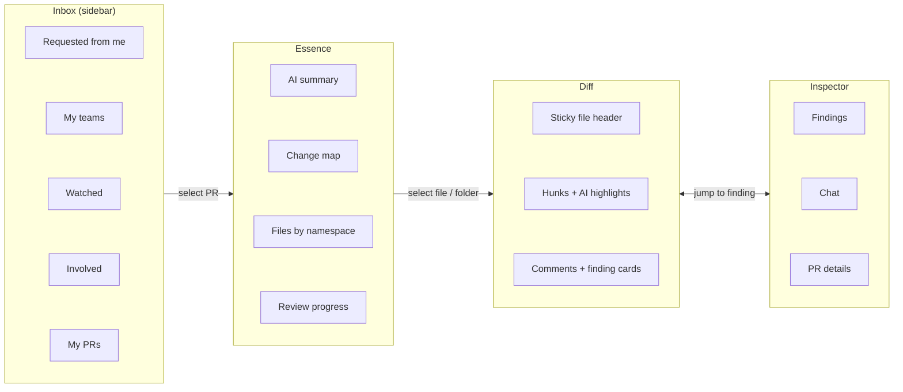
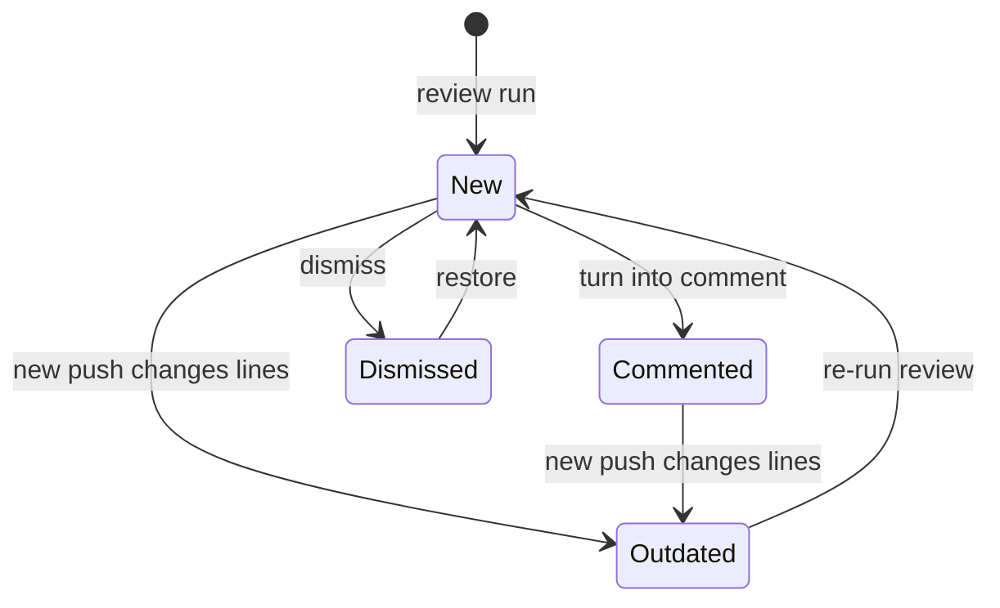

# Sylvra — UX

## 1. Design intent

**A quiet place for focused work.** Like a clearing in a forest: calm, spacious, natural light. The interface steps back so the code and its essence come forward.

- **Calm**: generous spacing, restrained color, motion only to explain state changes.
- **Clarity**: every screen answers one question first ("What changed?", "Where is the risk?", "What did the AI find?").
- **Precision**: crisp typography, monospaced code, exact alignment in diffs.
- **Native**: macOS conventions — sidebar, toolbar, inspector, menus, keyboard shortcuts, system materials (Liquid Glass), Dark and Light mode, accessibility.

## 2. Visual language

| Element | Direction |
|---|---|
| Palette | Deep violet neutrals (near-black aubergine, slate), soft off-white in light mode. Primary accent: a calm **deep violet**; secondary accent: a fine **gold** for highlights and focus (as in the app icon). Severity colors are muted, never neon. |
| Diff colors | Low-saturation green/red backgrounds, stronger tint only for intra-line changes. Color-blind safe alternative palette (blue/orange) in settings. |
| AI accent | A subtle multi-hue gradient (violet → indigo → teal) reserved **exclusively** for AI-generated content, so AI output is always recognizable. |
| Typography | SF Pro for UI, SF Mono (configurable) for code. Clear hierarchy, few sizes. |
| Iconography | SF Symbols, consistent weight. |
| Motion | Short, eased transitions; animated gradient shimmer only while an AI agent is running. Respects "Reduce Motion". |

## 3. Window layout

A three-column `NavigationSplitView` plus an optional inspector:

Toolbar: `◀ ▶  owner/repo #1234 Title   [Open in ▾] [✦ AI Review ▾] [Submit]`



- **Sidebar (Inbox)** — which PRs need my attention.
- **Essence column** — what this PR is about and where it changed.
- **Diff** — the code.
- **Inspector** — AI findings, chat, PR details (description, checks, reviewers, conversation).

Columns are collapsible. A *Focus mode* (⌃⌘F) hides sidebar and essence for maximum diff space.

## 4. Inbox (sidebar)

**Sections** (each collapsible, with count):

1. *Requested from me* — direct review requests.
2. *My teams* — team review requests and CODEOWNERS matches (the most important section, since most reviews are not assigned to me personally).
3. *Watched* — open PRs in watched repositories / paths.
4. *Involved* — mentioned, commented, previously reviewed.
5. *My PRs* — my own open PRs (for following up on feedback).
6. *Recently closed* — last 7 days.

**PR row** (two lines, compact):

```
 ◉  Add invoice export                          2h
    owner/repo #1234 · @alice · +340 −52 · ✓ CI · ⟳ updated
```

- Status dot: unread / updated since my last review / reviewed.
- Size indicator: subtle bar or label (XS–XL).
- Badges only for meaningful states: draft, conflicts, CI failing, *AI-authored*, *changes since my review*.

**Filtering & search**: search field (title, number, author, branch); filter chips for repo, author, size, CI state, draft. Saved filters appear as custom sections.

## 5. Essence column

The first thing visible when a PR is selected. Goal: **understand the PR in < 30 seconds.**

1. **Header** — title, author, branch `head → base`, CI status, review state, age.
2. **AI summary** (if available) — 2–4 sentences: intent, scope, risk areas. Marked with the AI accent. Button *Generate summary* if none exists.
3. **Change map** — structural visualization of namespaces/folders:
   - default: compact **treemap**, area = changed lines, color intensity = additions vs. deletions ratio, a soft AI glow on areas with findings;
   - alternative: **sunburst** or **indented tree with sparkline bars**.
   - Hover shows folder stats; click filters the file list and diff to that folder.
4. **Files by namespace** — tree grouped by folder/namespace (collapsing single-child folders), each file with +/−, kind icon, viewed checkmark, finding/comment counts.
   - Noise group (*Generated, lockfiles, snapshots*) collapsed at the bottom.
   - Optional *Suggested reading order* (AI) instead of alphabetical.
5. **Review progress** — "12 of 18 files viewed" as a slim progress bar.

## 6. Diff view

### 6.1 Modes

Toolbar segmented controls above the diff:

- **Layout**: `Side by side` | `Inline` (⌘⌥1 / ⌘⌥2)
- **Scope**: `Focused` (changed hunks + N context lines, N ∈ {3, 5, 10, custom}) | `Full file`
- **Range**: `All changes` | `Since my last review` | custom commit range
- Toggles: hide whitespace, wrap lines, show moved code.

Focused mode shows expandable separators ("⋯ 24 unchanged lines ⋯") — click to expand up/down/all.

### 6.2 Reading experience

- Sticky file headers with path, +/−, *Viewed* checkbox, *Open in IDE at this line*.
- Sticky scope header (current function/type) when scrolling inside long hunks.
- Intra-line highlights for changed tokens.
- Moved code shown with a distinct neutral tint and a link to its origin.
- Minimap/overview ruler on the right with markers for changes, comments and AI findings.

### 6.3 AI highlights (Xcode-style)

AI findings are rendered like AI-generated lines in Xcode:

- **Gradient background**: a soft horizontal gradient in the AI accent colors across the affected line range, fading out to the right. Opacity scales with severity.
- **Gradient border**: a thin rounded gradient stroke around the range for the *selected* finding.
- **Gutter marker**: a small ✦ icon in severity tint; hover shows the title, click opens the inline finding card.
- **Inline finding card** (below the range, collapsible): title, severity, category, rationale (markdown), optional suggested code shown as a mini-diff, actions: *Turn into comment*, *Dismiss*, *Ask in chat*, *Open in IDE*.
- While an AI review is running, affected files show a gentle animated shimmer in the file list; no shimmer in the code itself.
- Setting: *Background*, *Border*, or *Both*.

### 6.4 Existing comments

Existing review threads are shown inline (collapsible), with reply, resolve/unresolve and reaction actions. Outdated threads are marked and collapsed.

## 7. Commenting

- Hover a line → `+` button in the gutter; drag in the gutter to select a range. Shortcut: `C` on the selected line.
- **Composer** (inline, below the line range):
  - Markdown editor with preview.
  - **Insert suggestion** (⌘⇧S): inserts a ```` ```suggestion ```` block pre-filled with the selected lines, edited with syntax highlighting; a live mini-diff shows the result.
  - Actions: *Add to review* (default, pending) and *Comment now* (single comment).
- **From AI finding**: *Turn into comment* prefills title + rationale (editable, with a tone that fits a human reviewer) and the AI's suggestion as a suggestion block. The AI origin is never auto-labeled publicly; the reviewer owns the comment.
- **Pending review** indicator in the toolbar shows the number of pending comments. *Submit* opens a sheet: summary text, choice of *Comment / Approve / Request changes*, list of pending comments to review before sending.

## 8. AI review flow

**Toolbar button** `✦ AI Review` with a menu chevron:

```
✦ AI Review  ▾
  ─────────────────────────────
  Model:   [ Opus ▾ ]
  Effort:  [ Low | Medium | High ]
  Agents:  [ Auto (3) ▾ ]
  Scope:   ( ) Whole PR  ( ) Since last review  ( ) Selected files
  ─────────────────────────────
  Review guidelines: repo AGENTS.md ✓, custom prompt ✓
```

- Single click = run with last-used settings.
- **Progress** in the inspector: one row per agent/shard ("Billing — reading 4 files…"), streaming status, elapsed time, cancel button.
- Findings appear **live** as shards complete and are immediately visible in the diff.
- **Findings list** (inspector): grouped by severity or by file; filter by category; keyboard navigation (`J`/`K` next/previous finding, `↩` jump, `D` dismiss, `C` turn into comment).
- Each finding has a state: *new*, *commented*, *dismissed*, *outdated*.


- Review history: previous runs selectable (model, effort, SHA, duration).

## 9. Chat

- Inspector tab *Chat*, or a floating panel (⌘⇧K).
- Context chips above the input: PR, current file, selected lines, selected finding — removable.
- Answers render markdown; code references (`path:line`) are clickable and jump into the diff.
- Quick prompts: *Explain this change*, *Is this tested?*, *What could break?*, *Summarize discussion*.
- Uses the same model/effort picker as the review (independent defaults possible).

## 10. Open in IDE

- Toolbar button `Open in ▾` with the default IDE as primary action and the others in the menu: **Rider**, **Visual Studio Code**, **Xcode**.
- Per repository default IDE (e.g. .NET repo → Rider, iOS repo → Xcode).
- Context menu on files and lines: *Open in Rider at line 42*.
- Feedback: brief toast "Preparing worktree…" → "Opened in Rider".

## 11. Keyboard

| Action | Shortcut |
|---|---|
| Next / previous PR | `⌘↓` / `⌘↑` |
| Next / previous file | `]` / `[` |
| Next / previous hunk | `N` / `P` |
| Next / previous AI finding | `J` / `K` |
| Toggle viewed | `V` |
| Comment on line | `C` |
| Insert suggestion | `⌘⇧S` |
| Run AI review | `⌘⇧R` |
| Open chat | `⌘⇧K` |
| Open in default IDE | `⌘⇧O` |
| Side-by-side / inline | `⌘⌥1` / `⌘⌥2` |
| Focused / full file | `⌘⌥F` |
| Submit review | `⌘↩` |
| Quick open (PR or file) | `⌘P` |

A command palette (`⌘K`) exposes all actions.

## 12. Settings

- **Accounts** — GitHub sign-in (gh CLI token or device flow), organizations, teams.
- **Repositories** — watched repos, path watch rules, local clone mapping, default IDE per repo, file classification overrides.
- **IDEs** — detected IDEs, paths, default IDE.
- **AI** — Claude Code path and detected version, default model, default effort, max parallel agents, sharding threshold, cross-cutting pass on/off, custom review prompt (global and per repo), highlight style (background/border/both).
- **Diff** — default layout, default scope, context lines, font, whitespace, color-blind palette.
- **Worktrees** — location, retention, cleanup now.
- **Notifications** — new review requests, updates on reviewed PRs.

## 13. States

- **Empty inbox**: a calm illustration (a clearing), "Nothing to review. Enjoy the quiet."
- **Loading**: skeletons, never spinners in the middle of content.
- **Offline / rate-limited**: subtle banner, cached data stays usable.
- **Claude Code missing / not logged in**: inline guidance with a link to installation docs; AI features disabled, everything else works.
- **Errors**: human-readable message, details expandable, retry action.

## 14. Accessibility

- Full VoiceOver support including diff lines ("added line 42: …") and findings.
- Dynamic type for UI, adjustable code font size.
- No information by color alone: +/− symbols, severity icons, patterns for AI highlights.
- Reduce Motion and Increase Contrast honored.
